---
# The title slide is written by hand (slide 1 below) rather than generated
# from title/author metadata, so that it can carry speaker notes.
pagetitle: "Project ArHa"
description: "A global record of arenavirus and hantavirus sampling in small mammals, and what it can do. David Simons, INEEID Network, 20 October 2026."
format:
  revealjs:
    # 16:9, to fill the shared widescreen without side bars.
    width: 1280
    height: 720
    # Site fonts and the habitat-gradient section colours (deck.scss); the
    # section tracker and section-slide numbers (deck-tracker.html).
    theme: [default, deck.scss]
    include-in-header: deck-head.html
    include-after-body: deck-tracker.html
    slide-number: true
    hash: true
    transition: none
    preview-links: false
    footer: "Project ArHa · doi.org/10.5281/zenodo.21978982"
    # Speaker notes are kept in local renders and dropped on Netlify, so the
    # published deck carries slides only. See the filter.
    filters:
      - ../../filters/strip-notes.lua
execute:
  echo: false
# INEEID Network talk, online, 20 October 2026 at 22:00 Stockholm time
# (13:00 Pacific, Pullman). 45 minutes of speaking, then questions, in an
# hour's slot. Being online, the live globe can be screen-shared from a local
# quarto preview of the site. Timings are in each section's speaker notes and
# add to 45. Publishes with the site; render on its own with
# `quarto render presentations/2026-ineeid-arha/index.qmd`, but run a full
# `quarto render` first so the site figures it borrows are copied into _site/.
---

## {#title background-image="figures/uu_logo.png" background-size="190px" background-position="right 50px top 40px"}
<!-- Slide 1 -->

<style>
#title { text-align: center; padding-top: 150px; }
#title .t-title { font-family: "Newsreader Variable", Georgia, serif; font-size: 2.5em; font-weight: 600; line-height: 1.1; margin-bottom: 0.3em; }
#title .t-sub { font-size: 0.85em; max-width: 80%; margin: 0 auto 1.2em; }
#title .t-who { font-size: 0.85em; }
#title .t-inst { font-size: 0.6em; margin-bottom: 1em; }
#title .t-date { font-size: 0.75em; }
#title .t-venue { position: absolute; top: 52px; left: 0; font-size: 0.5em; color: #56605a; text-align: left; }
</style>

[INEEID Network seminar, online]{.t-venue}

[Project ArHa]{.t-title style="display:block"}
[A global record of arenavirus and hantavirus sampling in small mammals, and what it can do]{.t-sub style="display:block"}
[David Simons]{.t-who style="display:block"}
[Department of Ecology and Genetics, Uppsala University]{.t-inst style="display:block"}
[20 October 2026]{.t-date style="display:block"}

::: {.notes}
Hello, and thank you to Steph Seifert and the INEEID Network for having me. I'm David Simons, a Birgitta Sintring Fellow at Uppsala University.

Tonight I'll talk about Project ArHa. First, why arenaviruses and hantaviruses matter. Then how we built the database, what's in it, what it has let us do, and how you can use it.
:::

## The Gaps
<!-- Slide 2 -->

<!-- The earlier static map, kept until the globe has been checked in the browser used for the talk:
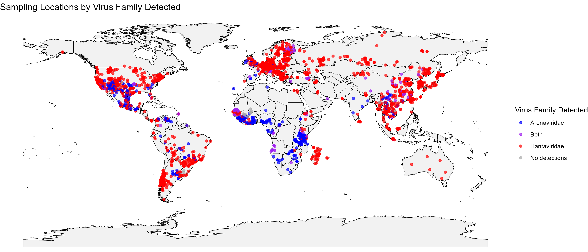{fig-alt="World map of small-mammal sampling locations for arenaviruses and hantaviruses, dense in Europe and North America and sparse across Africa and Asia."}
-->

:::: {.columns}
::: {.column width="64%"}
<canvas id="talk-globe" width="1200" height="1200" role="img" aria-label="Globe of small-mammal sampling locations for arenaviruses and hantaviruses, coloured by virus family detected. Dense in Europe, North America and parts of South America and West Africa; sparse across much of Africa and Asia."></canvas>
:::
::: {.column width="36%"}
::: {.globe-key}
[]{.sw style="background:#2a78d6"} Arenavirus detected\
[]{.sw style="background:#eb6834"} Hantavirus detected\
[]{.sw style="background:#1baf7a"} Both\
[]{.sw style="background:#5f625c"} Tested, none detected\
[]{.sw style="background:#a3a69f"} Not tested\
[]{.sw .ring} Country or adm1 centroid
:::

[]{#talk-globe-stop .globe-stop}

[Project ArHa v1.1, sampling locations]{#talk-globe-caption .globe-caption}
:::
::::

```{=html}
<style>
#talk-globe { width: 100%; max-width: 600px; height: auto; display: block; margin: 0 auto; }
.globe-key { font-size: 0.55em; line-height: 1.7; margin-top: 1.5em; }
.globe-key .sw { display: inline-block; width: 0.8em; height: 0.8em; border-radius: 50%; margin-right: 0.4em; vertical-align: -0.05em; }
.globe-key .sw.ring { border: 2px solid #5f625c; box-sizing: border-box; }
.globe-stop { font-size: 1.1em; font-weight: 600; margin-top: 1.2em; min-height: 1.6em; }
.globe-caption { display: block; font-size: 0.45em; color: #5f625c; margin-top: 2em; }
</style>
<script src="../../assets/js/d3.v7.9.0.min.js"></script>
<script>
// ArHa sampling globe for the talk. Data from scripts/build_talk_globe_data.R.
// While the slide is shown the globe tours the stops below on its own: it
// holds at each, then turns to the next. Click the globe to pause or resume.
// Turns interpolate longitude without wrapping, so Asia to North America goes
// back across Europe and the Atlantic, never the empty Pacific.
(() => {
  const stops = [            // [label, lon, lat]; edit, add or reorder freely
    ["Africa", 20, 2], ["Europe", 15, 50], ["Asia", 100, 25],
    ["North America", -95, 38], ["South America", -62, -20]];
  const holdMs = 3000, turnMs = 1400;
  const canvas = document.getElementById("talk-globe");
  const label = document.getElementById("talk-globe-stop");
  const ctx = canvas.getContext("2d");
  const size = canvas.width;
  const colours = { sea: "#f6f7f5", land: "#e4e6e1", edge: "#c6c9c2", gap: "#f6f7f5",
                    classes: ["#2a78d6", "#eb6834", "#1baf7a", "#5f625c", "#a3a69f"] };
  const projection = d3.geoOrthographic().fitExtent([[8, 8], [size - 8, size - 8]], { type: "Sphere" }).clipAngle(90);
  const path = d3.geoPath(projection, ctx);
  let land = null, points = [], timer = null;

  // Land rings that come out wound the wrong way would fill the whole sphere.
  const reverseRings = g => {
    if (g.type === "Polygon") g.coordinates = g.coordinates.map(r => r.slice().reverse());
    if (g.type === "MultiPolygon") g.coordinates = g.coordinates.map(p => p.map(r => r.slice().reverse()));
  };
  const fixWinding = f => { if (d3.geoArea(f) > 2 * Math.PI) reverseRings(f.geometry); return f; };

  function draw() {
    ctx.clearRect(0, 0, size, size);
    ctx.beginPath(); path({ type: "Sphere" }); ctx.fillStyle = colours.sea; ctx.fill();
    if (land) { ctx.beginPath(); path(land); ctx.fillStyle = colours.land; ctx.fill(); }
    ctx.beginPath(); path({ type: "Sphere" }); ctx.strokeStyle = colours.edge; ctx.lineWidth = 2; ctx.stroke();

    // Only points on the visible hemisphere. One path per class and marker
    // type, drawn from "not tested" up so detections sit on top.
    const r = projection.rotate(), centre = [-r[0], -r[1]];
    for (let k = colours.classes.length - 1; k >= 0; k--) {
      const filled = new Path2D(), rings = new Path2D();
      for (const p of points) {
        if (p[2] !== k || d3.geoDistance(p, centre) > Math.PI / 2) continue;
        const [x, y] = projection(p);
        if (p[3]) { rings.moveTo(x + 7, y); rings.arc(x, y, 7, 0, 2 * Math.PI); }
        else { filled.moveTo(x + 4.5, y); filled.arc(x, y, 4.5, 0, 2 * Math.PI); }
      }
      ctx.lineWidth = 1.2; ctx.strokeStyle = colours.gap; ctx.stroke(filled);
      ctx.fillStyle = colours.classes[k]; ctx.fill(filled);
      ctx.lineWidth = 2.5; ctx.strokeStyle = colours.classes[k]; ctx.stroke(rings);
    }
  }

  // The tour: show stop i, hold, turn to stop i + 1, repeat.
  let current = 0, running = false, paused = false, hold = null;
  const rotation = s => [-s[1], -s[2], 0];
  const show = i => { current = i; label.textContent = stops[i][0]; projection.rotate(rotation(stops[i])); draw(); };

  function next() {
    if (!running || paused) return;
    const i = (current + 1) % stops.length;
    const step = d3.interpolate(rotation(stops[current]), rotation(stops[i]));
    label.textContent = "";
    timer = d3.timer(elapsed => {
      const t = Math.min(1, elapsed / turnMs);
      projection.rotate(step(d3.easeCubicInOut(t))); draw();
      if (t === 1) { timer.stop(); timer = null; show(i); hold = setTimeout(next, holdMs); }
    });
  }
  function start() { stop(); running = true; paused = false; show(0); hold = setTimeout(next, holdMs); }
  function stop() { running = false; clearTimeout(hold); if (timer) { timer.stop(); timer = null; } }
  canvas.addEventListener("click", () => {
    if (!running) return;
    paused = !paused;
    if (!paused && !timer) { clearTimeout(hold); hold = setTimeout(next, 600); }
  });

  projection.rotate(rotation(stops[0]));
  let ready = false;
  Promise.all([d3.json("../../assets/data/land_110m.json"), d3.json("data/arha_points.json")])
    .then(([l, d]) => {
      l.features.forEach(fixWinding); land = l; points = d.points; ready = true;
      if (typeof Reveal !== "undefined" && Reveal.isReady && Reveal.isReady() && onThisSlide()) start(); else show(0);
    })
    .catch(e => { console.error(e); document.getElementById("talk-globe-caption").textContent = "The globe could not load its data."; });

  // Reveal is initialised after this script runs, so attach once the page has
  // loaded. The tour runs only while this slide is on screen.
  const onThisSlide = () => Reveal.getCurrentSlide() === canvas.closest("section");
  window.addEventListener("load", () => {
    Reveal.on("slidechanged", () => { if (onThisSlide()) { if (ready) start(); } else stop(); });
    Reveal.on("ready", () => { if (ready && onThisSlide()) start(); });
  });
})();
</script>
```

::: {.notes}
1. Arenaviruses and hantaviruses are zoonoses. Between them they cause Lassa fever and the South American haemorrhagic fevers, and haemorrhagic fever with renal syndrome and hantavirus pulmonary syndrome. The reported numbers are all undercounts, but they give a sense of scale.
    - In Nigeria in 2025 there were 1,148 confirmed Lassa fever cases, and 215 of them died, 18.7%, nearly one in five. That's from 9,389 suspected cases.
    - In the Americas, there were 229 confirmed cases of hantavirus pulmonary syndrome in 2025 up to week 47, and 59 deaths, about a quarter. Most were in the Southern Cone, so mostly Andes virus. In the United States, Sin Nombre virus caused 20 cases and 8 deaths in 2024, and 7 cases and 2 deaths in 2025 so far.
    - For haemorrhagic fever with renal syndrome I couldn't find a recent national total. China reported 91,388 cases between 2014 and 2023, about 9,000 a year, from Hantaan and Seoul viruses.
    - And for LCMV there's no burden estimate at all. Serosurveys find 3 to 5% of people in the US have been exposed, and congenital infection is probably underdiagnosed because few labs can test for it. A burden we can't see because nobody tests: that's the next slide in miniature.
2. Why we care: these outbreaks hit the most marginalised people hardest.
3. The hosts are mostly rodents, but also shrews, bats and other small mammals.
4. And what we know about where these viruses circulate is limited by where we've looked. Every point on this globe is a place someone sampled small mammals for these viruses. The empty land is where nobody looked. It isn't where the viruses are absent.

*Don't give database numbers yet. They come on slide 7, after how it was built.*

*The globe tours on its own: Africa, Europe, Asia, North America, South America, about four and a half seconds each, about 22 seconds a circuit. Click to pause. If asked: colour is the virus family detected by any assay, so serology counts; hollow rings are country or first-level admin centroids, not sampling sites.*

*Sources: NCDC week 52 situation report, 27 December 2025 (year-end table in `lassa-cfr/R/11_year_end.R`); PAHO epidemiological alert, 19 December 2025 (US 2025 figures provisional); China CDC Weekly 2025, 10.46234/ccdcw2025.141. China's 2024 national report groups HFRS with other natural-focus diseases, so it gives no separate figure.*
:::

## The problem
<!-- Slide 3 -->

- Host-pathogen records are scattered across decades of papers, reports and languages
- Sampling events and outcomes presented in a range of formats
- Non-detections are rarely reported, so absence and not-looking look the same
- Without sampling effort, bias cannot be separated from biology

::: {.notes}
**Part of the 3 minutes above.** *One slide, fast. It sets up why effort and non-detections were the two things the database had to capture.*

- **Scattered.** The records are scattered. They sit in journal articles, theses and grey-literature reports, in several languages. There's no single place to find them, and each study was designed for its own question.
- **Formats.** They come in every format. Some studies report each animal, or a single animal. Others give a total per site or per study. Some give trap nights; most don't. Assay names vary, and a location can be a GPS point or just a country. Making all that comparable is most of the work.
- **Non-detections.** Papers tend to report the positives. If a species was tested and came back negative, it's often left out, or it only appears in a total. So a gap in the record can mean we looked and found nothing, or we never looked, and you can't tell which. And non-detections matter for more than absence. They tell you effort: how many animals of which species were tested, and where. And they're the true negatives a model needs to tell a non-host from a species nobody has tested.
- **Effort.** Without effort, the species with the most detections may just be the species sampled most. That bias carries through into everything downstream. And across several studies now, we're finding that effort is the strongest single effect.
:::

# How we built it
<!-- Slide 4 -->
<!-- Database architecture, redrawn from the pipeline figure in the arenavirus_hantavirus README (project_organisation.png) and its list of scripts. -->

```{=html}
<svg class="arch" viewBox="0 0 1000 500" role="img" aria-labelledby="arch-title arch-desc">
<title id="arch-title">How the ArHa database is built</title>
<desc id="arch-desc">Extracted literature and four external sources feed five processing stages: citations, hosts, pathogens, sequences, then quality checks. They produce one relational database, released as open tables.</desc>
<defs>
  <marker id="arch-arrow" viewBox="0 0 10 10" refX="9" refY="5" markerWidth="7" markerHeight="7" orient="auto-start-reverse"><path d="M0,0 L10,5 L0,10 z" fill="#8a8d86"/></marker>
</defs>
<g font-family="inherit" fill="#1e2420">
  <!-- Column labels -->
  <g font-size="15" fill="#5f625c" letter-spacing="0.06em">
    <text x="0" y="14">SOURCES</text><text x="300" y="14">PROCESSING</text><text x="760" y="14">OUTPUT</text>
  </g>

  <!-- Sources -->
  <g font-size="16">
    <rect x="0" y="30" width="220" height="60" rx="6" fill="#fff" stroke="#8a8d86" stroke-dasharray="4 3"/>
    <text x="110" y="56" text-anchor="middle" font-weight="600">Extracted literature</text>
    <text x="110" y="77" text-anchor="middle" font-size="13" fill="#5f625c">728 studies</text>
    <rect x="0" y="110" width="220" height="44" rx="6" fill="#fff" stroke="#8a8d86" stroke-dasharray="4 3"/>
    <text x="110" y="138" text-anchor="middle">GBIF backbone</text>
    <rect x="0" y="166" width="220" height="44" rx="6" fill="#fff" stroke="#8a8d86" stroke-dasharray="4 3"/>
    <text x="110" y="194" text-anchor="middle">GADM boundaries</text>
    <rect x="0" y="228" width="220" height="44" rx="6" fill="#fff" stroke="#8a8d86" stroke-dasharray="4 3"/>
    <text x="110" y="256" text-anchor="middle">NCBI Taxonomy</text>
    <rect x="0" y="328" width="220" height="44" rx="6" fill="#fff" stroke="#8a8d86" stroke-dasharray="4 3"/>
    <text x="110" y="356" text-anchor="middle">GenBank</text>
  </g>
  <g stroke="#8a8d86" stroke-width="1.5" fill="none" marker-end="url(#arch-arrow)">
    <path d="M220,60 H298"/>
    <path d="M220,132 H298"/><path d="M220,188 C260,188 260,172 298,172"/>
    <path d="M220,250 H298"/>
    <path d="M220,350 H298"/>
  </g>

  <!-- Processing stages -->
  <g>
    <rect x="300" y="30" width="380" height="64" rx="6" fill="#eef1eb" stroke="#c6c9c2"/>
    <text x="318" y="56" font-size="17" font-weight="600">1 · Citations</text>
    <text x="318" y="80" font-size="14" fill="#5f625c">screening decisions, study descriptions</text>
    <rect x="300" y="112" width="380" height="80" rx="6" fill="#eef1eb" stroke="#c6c9c2"/>
    <text x="318" y="138" font-size="17" font-weight="600">2 · Hosts</text>
    <text x="318" y="161" font-size="14" fill="#5f625c">which species, where, when, with what effort;</text>
    <text x="318" y="180" font-size="14" fill="#5f625c">non-detections added where effort is clear</text>
    <rect x="300" y="218" width="380" height="64" rx="6" fill="#eef1eb" stroke="#c6c9c2"/>
    <text x="318" y="244" font-size="17" font-weight="600">3 · Pathogens</text>
    <text x="318" y="268" font-size="14" fill="#5f625c">test results for each host record</text>
    <rect x="300" y="318" width="380" height="64" rx="6" fill="#eef1eb" stroke="#c6c9c2"/>
    <text x="318" y="344" font-size="17" font-weight="600">4 · Sequences</text>
    <text x="318" y="368" font-size="14" fill="#5f625c">accessions linked to host and pathogen records</text>
    <rect x="300" y="408" width="380" height="64" rx="6" fill="#eef1eb" stroke="#c6c9c2"/>
    <text x="318" y="434" font-size="17" font-weight="600">5 · Quality checks and assembly</text>
    <text x="318" y="458" font-size="14" fill="#5f625c">QA report, consistent names and order</text>
  </g>
  <g stroke="#8a8d86" stroke-width="1.5" fill="none" marker-end="url(#arch-arrow)">
    <path d="M490,94 V110"/><path d="M490,192 V216"/><path d="M490,282 V316"/><path d="M490,382 V406"/>
  </g>

  <!-- Output -->
  <rect x="760" y="408" width="240" height="64" rx="6" fill="#1e2420"/>
  <text x="880" y="434" text-anchor="middle" font-size="17" font-weight="600" fill="#f6f7f5">Relational database</text>
  <text x="880" y="458" text-anchor="middle" font-size="14" fill="#c9cdc6">five linked tables</text>
  <rect x="760" y="230" width="240" height="120" rx="6" fill="#fff" stroke="#1e2420" stroke-width="1.5"/>
  <text x="880" y="258" text-anchor="middle" font-size="17" font-weight="600">Open release</text>
  <text x="880" y="284" text-anchor="middle" font-size="14" fill="#5f625c">Darwin Core and parquet tables</text>
  <text x="880" y="306" text-anchor="middle" font-size="14" fill="#5f625c">versioned DOI on Zenodo</text>
  <text x="880" y="328" text-anchor="middle" font-size="14" fill="#5f625c">explorer app</text>
  <g stroke="#8a8d86" stroke-width="1.5" fill="none" marker-end="url(#arch-arrow)">
    <path d="M680,440 H758"/><path d="M880,408 V352"/>
  </g>
</g>
</svg>
<style>.arch { width: 100%; max-height: 560px; display: block; margin-top: 0.4em; }</style>
```

::: {.notes}
**6 minutes across slides 4 to 6. Section 2 of 7.** *Keep this one to the shape: what goes in, what happens to it, what comes out. Slide 5 is the search, slide 6 the harmonising.*

- **Sources.** Everything starts from the literature we extracted. We used four outside sources to standardise it: the GBIF backbone for host names, GADM for administrative areas, NCBI Taxonomy for virus names and GenBank for sequence metadata.
- **Processing.** Then five stages run in order. Each one is a set of R scripts that saves its output for the next. Most of the work is on the hosts, and one step there is worth naming. Where a study reports clear effort, and a species from that study wasn't caught at a site, we add a zero record. That's how non-detections get into the database.
- **Principle.** One principle runs through it: the published paper is the source of truth. GenBank metadata is often thinner than the paper, so the paper fills in the sequence record, not the other way round.
- **Output.** What comes out is one relational database of linked tables, released openly with a DOI. I'll show what's in it on slide 8.
:::

## Search, screen, extract
<!-- Slide 5 -->

:::: {.columns}
::: {.column width="72%"}
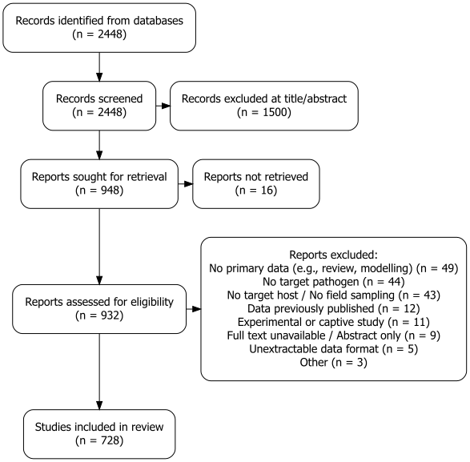{fig-alt="PRISMA flow diagram: 2,448 records screened, 1,500 excluded at title and abstract, 948 reports sought, 932 assessed for eligibility, 728 studies included." height="580"}
:::
::: {.column width="28%" .qr-col}
{fig-alt="QR code linking to the Project ArHa protocol in Wellcome Open Research." width="220"}

[Protocol, Wellcome Open Research\
doi.org/10.12688/wellcomeopenres.24037.2]{.qr-label}
:::
::::

```{=html}
<style>
.qr-col { padding-top: 6em; }
.qr-label { display: block; font-size: 0.42em; line-height: 1.4; color: #5f625c; }
</style>
```

::: {.notes}
**Part of the 6 minutes for this section.**

- **Search.** We searched PubMed and Web of Science for primary research from January 1960 to August 2023 on arenavirus or hantavirus infection in small mammals, so rodents and shrews. The protocol is published in Wellcome Open Research.
- **Screen.** That gave 2,448 records, and we excluded 1,500 at title and abstract. To stay in, a study had to report primary surveillance data, by PCR or serology, with an identifiable host and a location.
- **Full text.** We sought 948 reports and read 932. The commonest reasons to exclude were no primary data, so reviews and models; no target virus; and no target host or no field sampling.
- **Extract.** That left 728 studies, and we extracted each one to the template in the protocol. What one of those records looks like, and why that was hard, is the next slide.

And I want to credit Steph Seifert and the Verena Fellows-in-Residence programme here.

*Figure: Supplementary Figure 1 of the macroecology manuscript. Protocol: 10.12688/wellcomeopenres.24037.2.*
:::

## Harmonisation
<!-- Slide 6 -->

```{=html}
<svg class="harm" viewBox="0 0 1000 520" role="img" aria-labelledby="harm-title harm-desc">
<title id="harm-title">Harmonising studies that report at different scales</title>
<desc id="harm-desc">Four kinds of source record, a single sequenced animal, a species count from years at one site, counts broken down by site or session, and individual animal data, are resolved to the finest time and space available, with dates, coordinates, names and assays standardised. The result is a host record linked to a pathogen measurement. The end point is a shared data standard.</desc>
<defs>
  <marker id="harm-arrow" viewBox="0 0 10 10" refX="9" refY="5" markerWidth="7" markerHeight="7" orient="auto-start-reverse"><path d="M0,0 L10,5 L0,10 z" fill="#8a8d86"/></marker>
</defs>
<g font-family="inherit" fill="#1e2420">
  <g font-size="15" fill="#5f625c" letter-spacing="0.06em">
    <text x="0" y="14">AS REPORTED</text><text x="310" y="14">HARMONISED</text><text x="740" y="14">AS STORED</text>
  </g>

  <!-- As reported: four reporting units, coarsest to finest after the first -->
  <g font-size="14">
    <rect x="0" y="30" width="240" height="78" rx="6" fill="#fff" stroke="#8a8d86" stroke-dasharray="4 3"/>
    <text x="16" y="54" font-size="17" font-weight="600">One animal</text>
    <text x="16" y="76" fill="#5f625c">reported because a virus</text>
    <text x="16" y="94" fill="#5f625c">was sequenced from it</text>
    <rect x="0" y="118" width="240" height="78" rx="6" fill="#fff" stroke="#8a8d86" stroke-dasharray="4 3"/>
    <text x="16" y="142" font-size="17" font-weight="600">One count</text>
    <text x="16" y="164" fill="#5f625c">a species total from four</text>
    <text x="16" y="182" fill="#5f625c">years at a single site</text>
    <rect x="0" y="206" width="240" height="78" rx="6" fill="#fff" stroke="#8a8d86" stroke-dasharray="4 3"/>
    <text x="16" y="230" font-size="17" font-weight="600">Stratified count</text>
    <text x="16" y="252" fill="#5f625c">species totals broken down</text>
    <text x="16" y="270" fill="#5f625c">by site or session</text>
    <rect x="0" y="294" width="240" height="78" rx="6" fill="#fff" stroke="#8a8d86" stroke-dasharray="4 3"/>
    <text x="16" y="318" font-size="17" font-weight="600">Individual animals</text>
    <text x="16" y="340" fill="#5f625c">each with its own date,</text>
    <text x="16" y="358" fill="#5f625c">place and result</text>
  </g>
  <g stroke="#8a8d86" stroke-width="1.5" fill="none" marker-end="url(#harm-arrow)">
    <path d="M240,69 C280,69 280,135 308,135"/><path d="M240,157 C275,157 275,165 308,165"/>
    <path d="M240,245 C275,245 275,195 308,195"/><path d="M240,333 C280,333 280,225 308,225"/>
  </g>

  <!-- Harmonised -->
  <rect x="310" y="110" width="360" height="124" rx="6" fill="#eef1eb" stroke="#c6c9c2"/>
  <text x="328" y="138" font-size="17" font-weight="600">Resolve the sampling unit</text>
  <text x="328" y="162" font-size="14" fill="#5f625c">the finest time and space available</text>
  <text x="328" y="181" font-size="14" fill="#5f625c">for each animal sampled; pathogen status</text>
  <text x="328" y="200" font-size="14" fill="#5f625c">kept at its own scale, e.g. pooled tests</text>
  <g font-size="14">
    <rect x="310" y="252" width="174" height="50" rx="6" fill="#eef1eb" stroke="#c6c9c2"/>
    <text x="324" y="273" font-weight="600">Dates</text><text x="324" y="292" fill="#5f625c">dozens of formats</text>
    <rect x="496" y="252" width="174" height="50" rx="6" fill="#eef1eb" stroke="#c6c9c2"/>
    <text x="510" y="273" font-weight="600">Coordinates</text><text x="510" y="292" fill="#5f625c">formats and precision</text>
    <rect x="310" y="312" width="174" height="50" rx="6" fill="#eef1eb" stroke="#c6c9c2"/>
    <text x="324" y="333" font-weight="600">Names</text><text x="324" y="352" fill="#5f625c">host and virus taxonomy</text>
    <rect x="496" y="312" width="174" height="50" rx="6" fill="#eef1eb" stroke="#c6c9c2"/>
    <text x="510" y="333" font-weight="600">Assays</text><text x="510" y="352" fill="#5f625c">free text to set terms</text>
  </g>
  <path d="M670,236 H738" stroke="#8a8d86" stroke-width="1.5" fill="none" marker-end="url(#harm-arrow)"/>

  <!-- As stored -->
  <rect x="740" y="110" width="260" height="90" rx="6" fill="#1e2420"/>
  <text x="758" y="138" font-size="17" font-weight="600" fill="#f6f7f5">Host record</text>
  <text x="758" y="162" font-size="14" fill="#c9cdc6">species, where, when,</text>
  <text x="758" y="181" font-size="14" fill="#c9cdc6">how many</text>
  <rect x="740" y="272" width="260" height="90" rx="6" fill="#1e2420"/>
  <text x="758" y="300" font-size="17" font-weight="600" fill="#f6f7f5">Pathogen measurement</text>
  <text x="758" y="324" font-size="14" fill="#c9cdc6">virus, assay,</text>
  <text x="758" y="343" font-size="14" fill="#c9cdc6">tested, positive</text>
  <path d="M870,200 V272" stroke="#1e2420" stroke-width="2"/>
  <text x="882" y="241" font-size="14" fill="#5f625c">linked</text>

  <!-- End point -->
  <rect x="0" y="400" width="1000" height="74" rx="6" fill="#fff" stroke="#1e2420" stroke-width="1.5"/>
  <text x="20" y="430" font-size="17" font-weight="600">The end point: a data standard</text>
  <text x="20" y="456" font-size="14" fill="#5f625c">If studies report in a shared format, this work is done once, at source. Minimum data standard, Scientific Data 2025.</text>
</g>
</svg>
<style>.harm { width: 100%; max-height: 560px; display: block; margin-top: 0.4em; }</style>
```

::: {.notes}
**Part of the 6 minutes for this section.** *Harmonisation runs across the whole record, not only taxonomy.*

- **Reporting units.** Studies report at very different scales. Some report one animal, because they sequenced a virus from it. In others, one record is four years of trapping at a site, with just a species count. Some break those counts down by site or by trapping session. Others share data for every animal.
- **Sampling unit.** We harmonised across all of these to get the finest resolution each study allows, in time and space, for the sampling of an animal. Pathogen status sits on top of that, and sometimes it's reported at a different scale, for example pooled testing of several animals.
- **Fields.** Then the fields themselves. Dates in dozens of formats. Coordinates in different formats and at different precision. Host and virus names matched to current taxonomies. And assay descriptions turned into a fixed set of terms.
- **Stored.** What comes out is a host record, so species, where, when and how many, linked to a pathogen measurement: virus, assay, number tested and number positive.
- **End point.** Truly harmonised data wouldn't need any of this. That's the point of the data standard we published in Scientific Data last year. If you report in a shared format, the work is done once, at source.

*Data standard: Scientific Data 2025, 10.1038/s41597-025-05332-x.*
:::

# What it contains
<!-- Slide 7 -->

::: {.stat-grid}
::: {.stat}
[728]{.n}
[studies]{.l}
:::
::: {.stat}
[54,984]{.n}
[host records]{.l}
:::
::: {.stat}
[4,942]{.n}
[locations in 103 countries]{.l}
:::
::: {.stat}
[748]{.n}
[host species]{.l}
:::
::: {.stat}
[~695,000]{.n}
[tests for arenaviruses and hantaviruses]{.l}
:::
:::

```{=html}
<style>
.stat-grid { display: grid; grid-template-columns: repeat(3, 1fr); gap: 1.2em 1.6em; margin-top: 0.8em; }
.stat { border-top: 3px solid #1e2420; padding-top: 0.3em; }
.stat .n { display: block; font-size: 1.6em; font-weight: 700; line-height: 1.1; }
.stat .l { display: block; font-size: 0.6em; color: #5f625c; }
</style>
```

::: {.notes}
**6 minutes across slides 7 to 9. Section 3 of 7.** *Now they know how it was built, give the size.*

- **Studies.** 728 studies. Each one a different team, question and design, now all in one format.
- **Host records.** 54,984 host records. A record is a species at a place and time. That can be one animal, or a count over years, as on the last slide.
- **Locations.** 4,942 distinct locations in 103 countries. Most are trap sites. The rest are coarser, down to a country centroid.
- **Species.** 748 host species. Mostly rodents, 593 of them, and shrews, 74, but also marsupials, bats and others.
- **Tests.** And about 695,000 tests. That's the number of animals tested, summed across all measurements, so an animal tested for both virus families counts twice.

*If asked why the paper says 637 species: the macroecology paper applies a taxonomic filter. Numbers are from the v1.1 release (the parquet tables); studies follow the PRISMA figure.*
:::

## Four linked tables
<!-- Slide 8 -->

```{=html}
<svg class="schema" viewBox="0 0 1000 430" role="img" aria-labelledby="schema-title schema-desc">
<title id="schema-title">The four tables of the ArHa release</title>
<desc id="schema-desc">Sampling events, 729 rows, link to host occurrences, 54,984 rows. Each host occurrence links to pathogen measurements, 69,186 rows, and to sequence links, 13,860 rows, which point to GenBank.</desc>
<defs>
  <marker id="schema-arrow" viewBox="0 0 10 10" refX="9" refY="5" markerWidth="7" markerHeight="7" orient="auto-start-reverse"><path d="M0,0 L10,5 L0,10 z" fill="#8a8d86"/></marker>
</defs>
<g font-family="inherit" fill="#1e2420">
  <!-- Sampling events -->
  <rect x="0" y="130" width="250" height="170" rx="6" fill="#eef1eb" stroke="#c6c9c2"/>
  <text x="18" y="160" font-size="18" font-weight="600">Sampling events</text>
  <text x="18" y="182" font-size="14" fill="#5f625c">study-level details</text>
  <text x="18" y="216" font-size="15">reference, year, protocol,</text>
  <text x="18" y="237" font-size="15">sampling effort</text>
  <text x="18" y="282" font-size="22" font-weight="700">729</text>

  <!-- Host occurrences -->
  <rect x="340" y="110" width="290" height="210" rx="6" fill="#1e2420"/>
  <text x="358" y="140" font-size="18" font-weight="600" fill="#f6f7f5">Host occurrences</text>
  <text x="358" y="162" font-size="14" fill="#c9cdc6">the central table</text>
  <text x="358" y="196" font-size="15" fill="#f6f7f5">species, place, date,</text>
  <text x="358" y="217" font-size="15" fill="#f6f7f5">number of animals, trap nights,</text>
  <text x="358" y="238" font-size="15" fill="#f6f7f5">coordinate precision</text>
  <text x="358" y="300" font-size="22" font-weight="700" fill="#f6f7f5">54,984</text>

  <!-- Pathogen measurements -->
  <rect x="720" y="20" width="280" height="170" rx="6" fill="#eef1eb" stroke="#c6c9c2"/>
  <text x="738" y="50" font-size="18" font-weight="600">Pathogen measurements</text>
  <text x="738" y="86" font-size="15">virus, assay,</text>
  <text x="738" y="107" font-size="15">number tested, number positive</text>
  <text x="738" y="172" font-size="22" font-weight="700">69,186</text>

  <!-- Sequence links -->
  <rect x="720" y="240" width="280" height="170" rx="6" fill="#eef1eb" stroke="#c6c9c2"/>
  <text x="738" y="270" font-size="18" font-weight="600">Sequence links</text>
  <text x="738" y="306" font-size="15">GenBank accessions for</text>
  <text x="738" y="327" font-size="15">host and virus sequences</text>
  <text x="738" y="392" font-size="22" font-weight="700">13,860</text>

  <g stroke="#8a8d86" stroke-width="1.5" fill="none" marker-end="url(#schema-arrow)">
    <path d="M250,215 H338"/>
    <path d="M630,170 C675,170 675,105 718,105"/>
    <path d="M630,260 C675,260 675,325 718,325"/>
  </g>
  <g font-size="13" fill="#5f625c">
    <text x="294" y="205" text-anchor="middle">eventID</text>
    <text x="712" y="92" text-anchor="end">occurrenceID</text>
    <text x="712" y="348" text-anchor="end">occurrenceID</text>
  </g>
</g>
</svg>
<style>.schema { width: 100%; max-height: 540px; display: block; margin-top: 0.6em; }</style>
```

[Darwin Core tables: Event, Occurrence, MeasurementOrFact, ResourceRelationship]{.refs}

::: {.notes}
**Part of the 6 minutes above.** *Show the shape of the release, so people know what they'd download. The release slide at the end says how to get and cite it, so don't describe the tables twice.*

- **Standard.** The release follows Darwin Core, the biodiversity data standard, so it loads into the same tools as GBIF data.
- **Events.** The events table holds the study-level details: the reference, year, sampling protocol and effort.
- **Host occurrences.** Host occurrences is the central table. Each row is a species at a place and time, with the number of animals, trap nights where they were reported, and how precise the coordinates are. Non-detections are rows here too.
- **Pathogen measurements.** Each test result hangs off a host record: virus, assay, number tested, number positive. Pooled tests sit here at their own scale.
- **Sequence links.** And 13,860 GenBank accessions, each tied to the host record it came from.
:::

## Where we look, and where we don't
<!-- Slide 9 -->

<!-- Parts cut from arha_fig1_surveillance_residuals.png by scripts/crop_talk_figures.R. -->
::: {.fig1-grid}
::: {.f1-left}
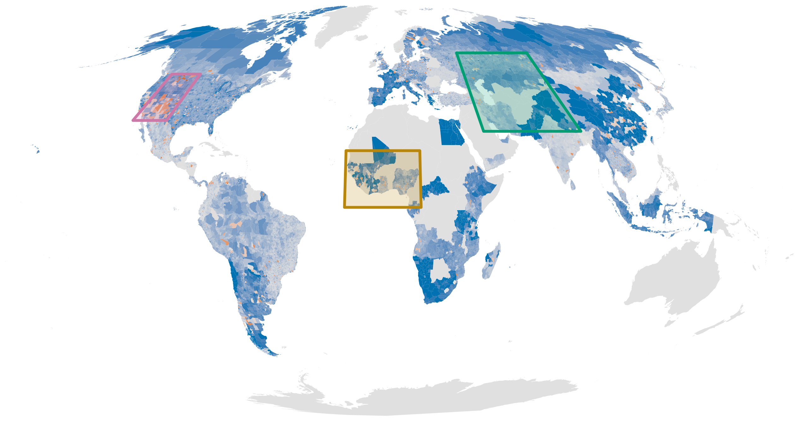{fig-alt="World map of surveillance residuals: districts sampled more (orange) or less (blue) than predicted by night-time light, accessibility, population density and host richness, with boxes marking the Intermountain West, West Africa and Central Asia."}

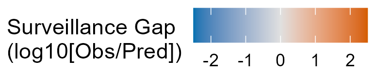{.f1-legend fig-alt="Colour key: surveillance gap, log10 of observed over predicted, from -2 (blue, undersampled) to 2 (orange, oversampled)."}
:::
::: {.f1-right}
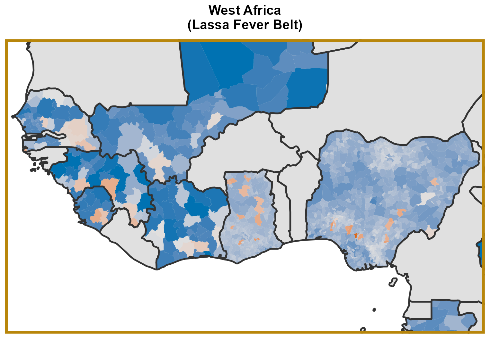{fig-alt="Inset: West Africa, the Lassa fever belt."}

::: {.f1-row}
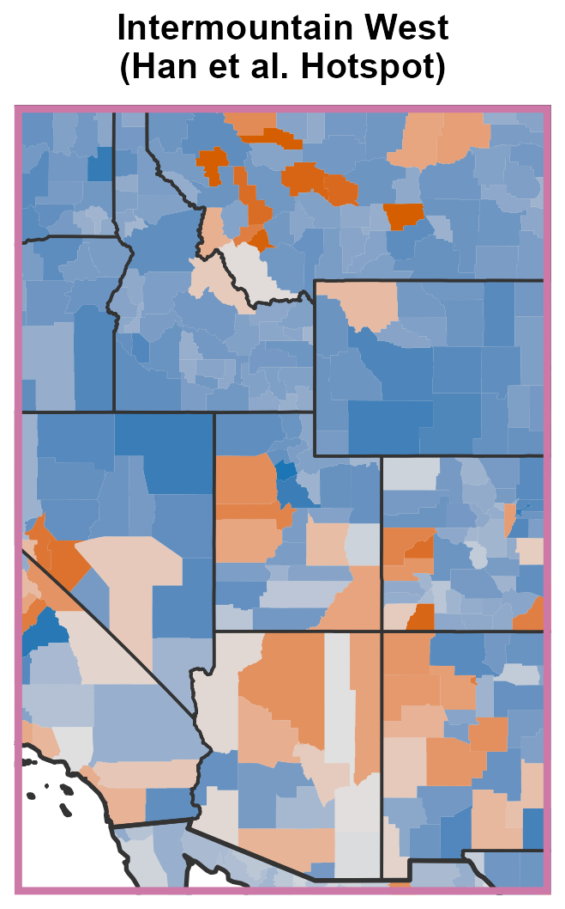{fig-alt="Inset: the Intermountain West of the United States, a hotspot in Han et al."}

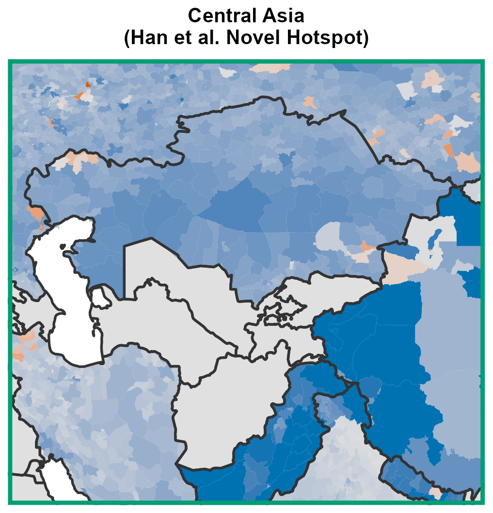{fig-alt="Inset: Central Asia, a novel hotspot in Han et al., largely undersampled."}
:::
:::
:::

```{=html}
<style>
.fig1-grid { display: grid; grid-template-columns: 60% 40%; gap: 0 18px; align-items: center; margin-top: 0.3em; }
.fig1-grid p, .fig1-grid figure, .fig1-grid .quarto-figure { margin: 0 !important; }
.fig1-grid img { margin: 0 !important; max-height: none !important; }
.f1-left img { width: 100%; }
.f1-left .f1-legend, .f1-left img.f1-legend { width: 42%; display: block; margin: 10px auto 0 !important; }
.f1-right img { width: 100%; }
.f1-row { display: flex; gap: 10px; margin-top: 10px; }
.f1-row img { height: 235px; width: auto; }
</style>
```

::: {.notes}
**Part of the 6 minutes for this section.** *Figure 1 of the macroecology manuscript.*

- So once we have all of this in one place, the first thing we can ask is: where have people actually looked, and why there?
- We modelled the number of animals tested in each district against night-time light, travel time to the nearest city, human population density and how many host species live there.
- Light and access predict sampling. If a district is bright and close to a city, it gets sampled more. How many host species live there makes no difference. It's a streetlight effect: we look where it's easy to look, not where the hosts are.
- This map is what's left over. Orange is districts sampled more than we'd expect from those things, blue is less. The insets pick out three: the Intermountain West in the US, sampled far more than expected; West Africa, where Lassa surveillance is targeted; and Central Asia, sampled far less.
- And it's not only places. 46% of rodent and shrew genera have never been sampled for these viruses at all.
- So anything we say about hosts from here on has to deal with this. That's where the next section starts.
:::

# Questions addressed using the whole database
<!-- Slide 10 -->

## What predicts host status
<!-- Slide 11 -->

<!-- Panels cut from arha_fig2_host_status.png by scripts/split_talk_figure.R. Panel a stays; b, c and d replace each other on key presses, in the order of the notes. -->
:::: {.columns}
::: {.column width="44%"}
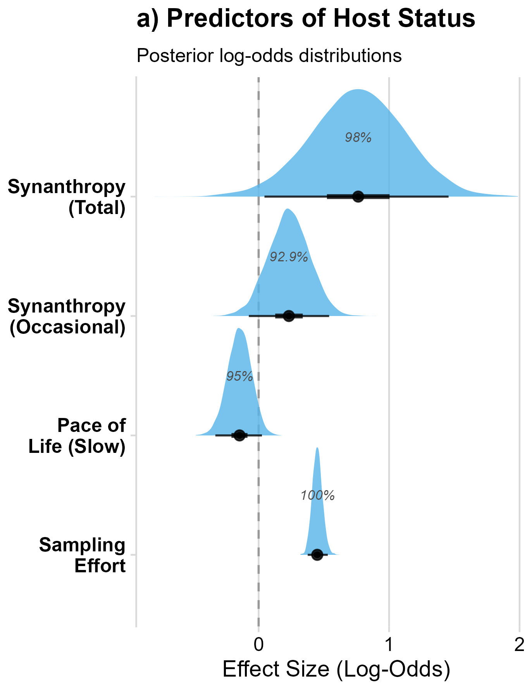{fig-alt="Posterior log-odds for total and occasional synanthropy, slow pace of life and sampling effort." height="490"}
:::
::: {.column width="56%"}
::: {.r-stack}
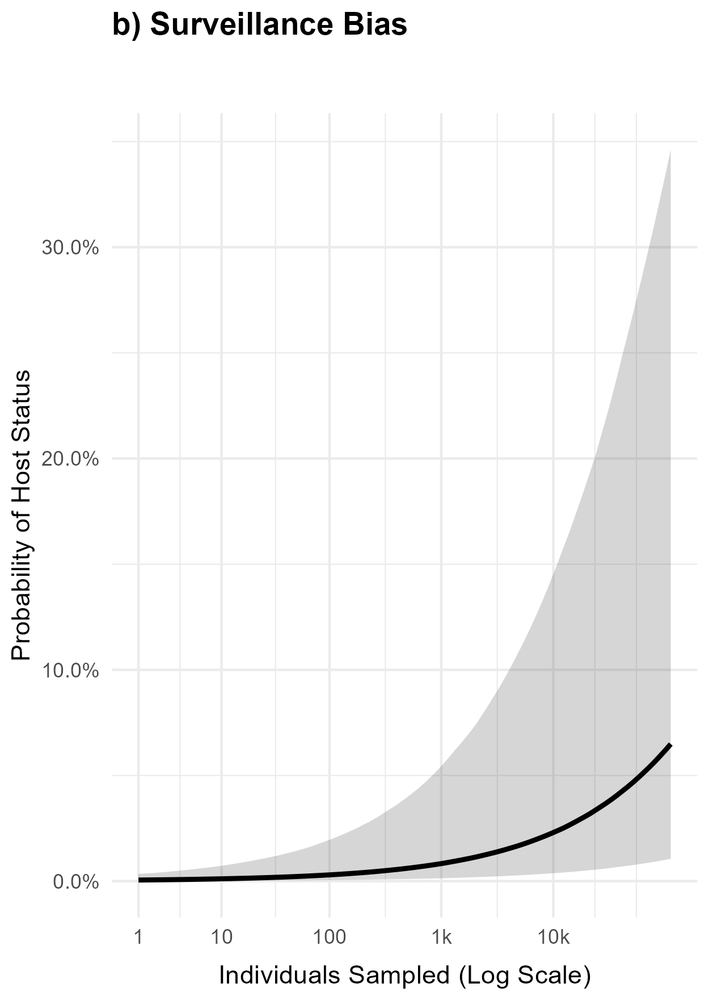{.fragment .fade-out fragment-index=1 fig-alt="Probability of host status rising with the number of individuals sampled, on a log scale." height="490"}

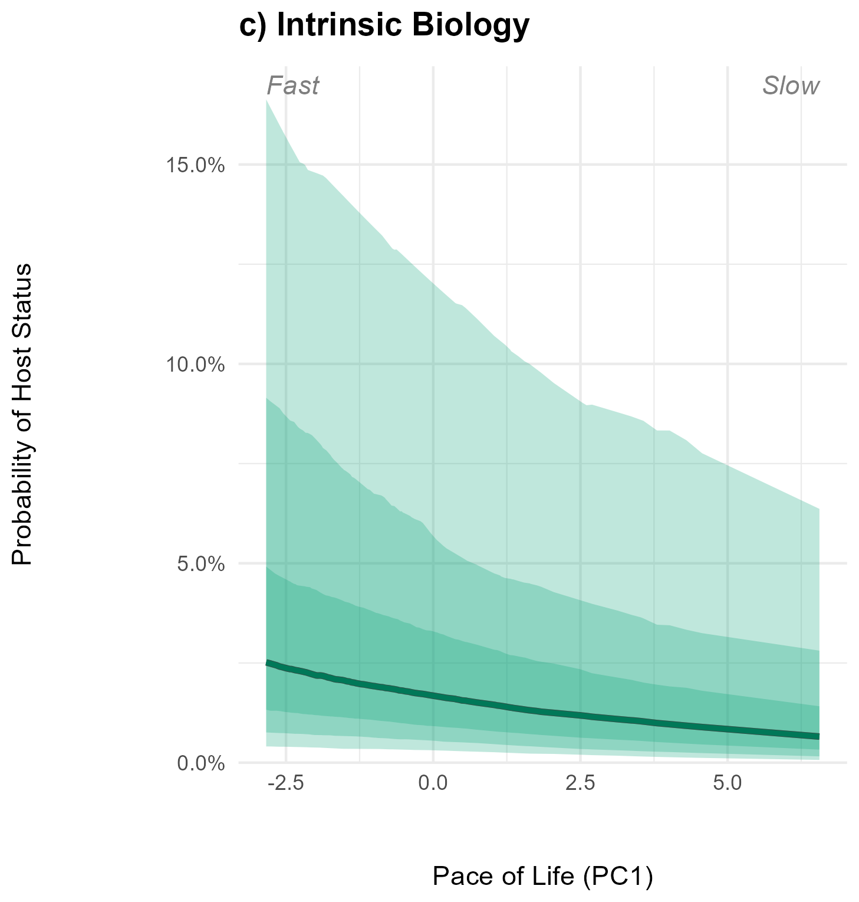{.fragment .fade-in-then-out fragment-index=1 fig-alt="Probability of host status falling from fast to slow pace of life." height="490"}

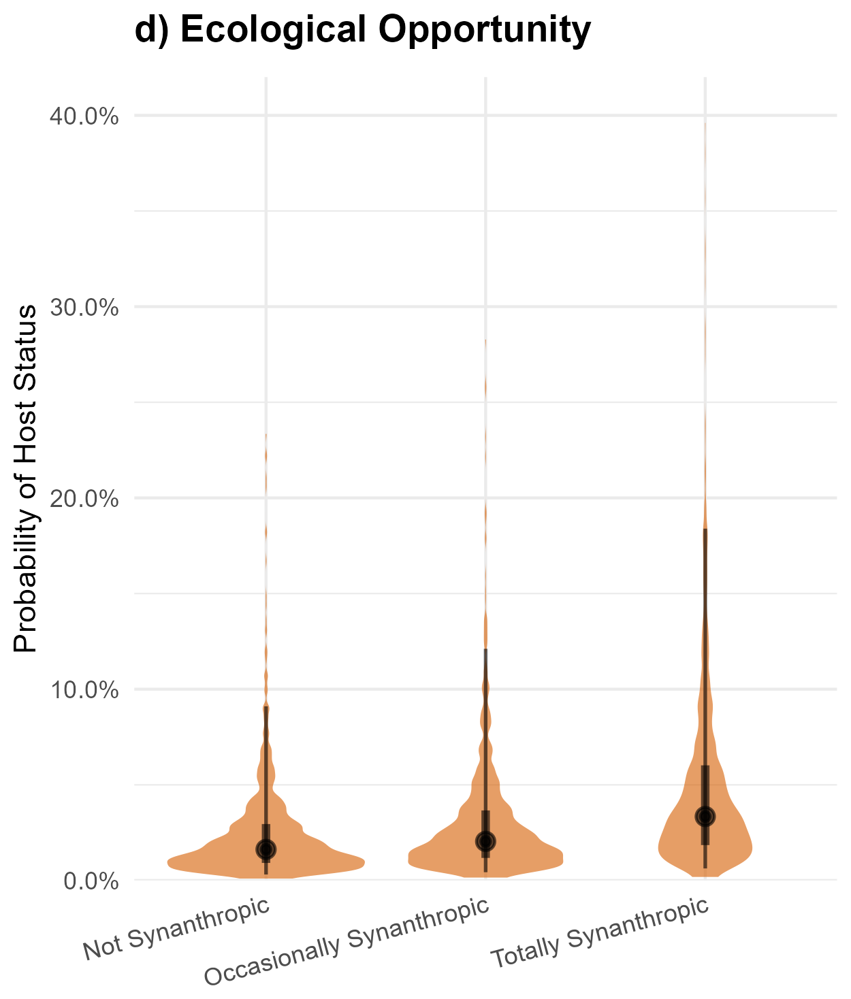{.fragment .fade-in fragment-index=2 fig-alt="Probability of host status for non-, occasionally and totally synanthropic species, highest for totally synanthropic." height="490"}
:::
:::
::::

[Life history: Cronin 2014, *Am Nat*; Ostfeld 2014, *PLoS ONE*. Ecological opportunity: Kamiya 2014, *Biol Rev*. Urban-adapted species: Albery 2022, *Nat Ecol Evol*.]{.refs}

::: {.slide-qr}
{fig-alt="QR code linking to the macroecology preprint on bioRxiv." width="96"}
[Preprint\
bioRxiv]{.qr-label}
:::

```{=html}
<style>
.slide-qr { position: absolute; right: 0; top: 0; text-align: right; }
.slide-qr p { display: flex; align-items: center; gap: 0.5em; margin: 0; }
.refs { position: absolute; top: auto; bottom: 34px; left: 0; right: 0; font-size: 0.4em; color: #5f625c; }
.slide-qr img { margin: 0 !important; }
.slide-qr .qr-label { order: -1; }
</style>
```

::: {.notes}
**8 minutes across slides 11 to 13. Section 4 of 7: the macroecology paper.** *Numbers follow the revised manuscript (v10), not the preprint the QR code links to.*

- **The question.** So, given all that bias, can we still say what makes a species a host? There are two main ideas. One comes from life history. Species that live fast, mature early and have big litters may invest less in adaptive immunity, and tolerate infection rather than clear it. The other is ecological opportunity. Generalists, and especially species that live alongside people, simply meet more viruses.
- **The catch.** The things that drive sampling, light, access and wealth, may line up with those same traits. Fast-lived commensals are exactly the species that get sampled in accessible places. So unless effort is in the model, bias can look like biology.
- **What we did.** We fitted Bayesian phylogenetic mixed models to 43,677 host–virus pairs, across 633 rodent and shrew species, with sampling effort in the model. We tested synanthropy in a subset of about 19,000 pairs where we could score it.
- *The slide: panel a, on the left, stays up throughout. The right shows panel b; each press brings in c, then d.*
- **Effort (panel b).** Effort comes first. It's the strongest and most certain effect. Look harder and you find more hosts.
- **Pace of life (panel c).** Faster-lived species tend to be detected as hosts more often. But the interval includes zero; the probability of direction is about 93%. So I'd say "tends to", not "predicts".
- **Synanthropy (panel d).** On top of that, species that live with people are more likely to be hosts. Obligate commensals have about twice the odds, though the interval only just excludes zero.
- **Does it hold up?** We left out each continent in turn and predicted it from the rest. The models separated hosts from non-hosts with an AUC of 0.81 to 0.88.
- And all of this depends on the database recording effort and non-detections, not only positives.
:::

## Hosts and viruses share a history, but not strictly
<!-- Slide 12 -->

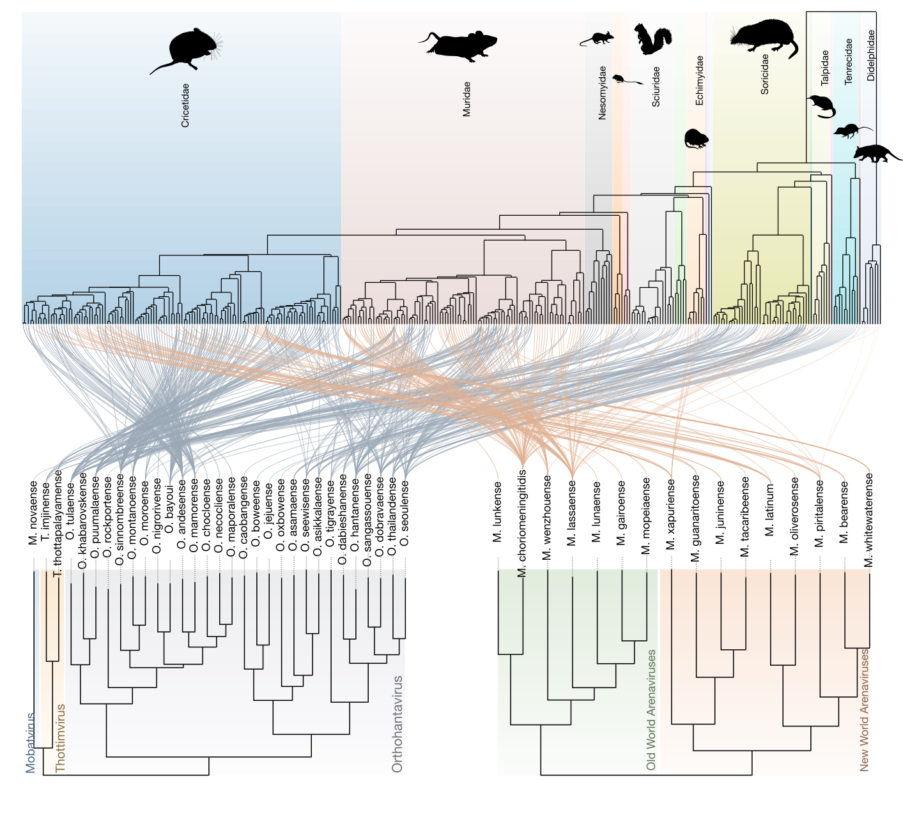{fig-alt="Tanglegram linking the mammalian host phylogeny above to hantavirus and arenavirus phylogenies below, with many crossing links." height="445" fig-align="center"}

[No codivergence in hantaviruses: Ramsden 2008, *Mol Biol Evol*. PACo: Balbuena 2013, *PLoS ONE*.]{.refs}

::: {.notes}
**Part of the 8 minutes for this section.** *Figure 4 of the manuscript (v10).*

- **The question.** The traits tell us which kinds of species tend to be hosts. The other side is history. Did these viruses evolve along with their hosts, or do they move between them?
- **The figure.** This is the host family tree along the top, and the virus trees underneath: hantaviruses on the left, arenaviruses on the right. Each line joins a virus to a host species it's been found in by PCR. Thick, dark lines are links that fit a shared history. Thin, faint ones don't, and those are the likely host switches.
- **What we did.** We compared the host and virus trees to see how well they line up. For the method detail, Ricardo is the person to ask.
- **What we found.** The answer is both. The trees line up broadly in both families, so there appears to be a real shared history at the level of lineages. But many of the individual links don't fit it, so viruses have also jumped between hosts again and again.
- **The pattern.** Hantaviruses sit mostly on Cricetidae, apart from the shrew-borne viruses. Arenaviruses split: Old World viruses on Muridae, New World on Cricetidae.
- **Why it matters.** So: one virus, many hosts, and hosts shared between viruses. One virus with one rodent reservoir undersells it. The unit that matters is probably the small-mammal community.
:::

## Where host probability is high
<!-- Slide 13 -->

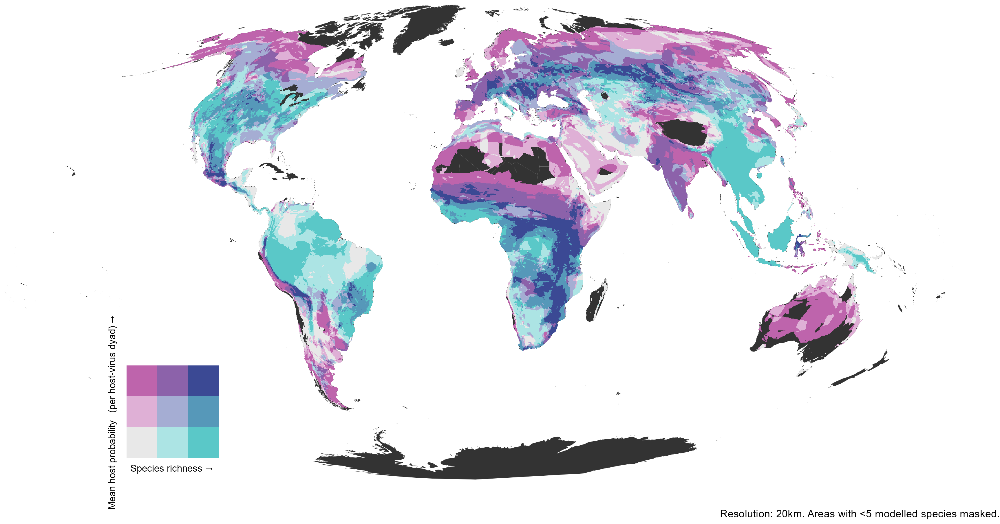{fig-alt="Bivariate world map of small-mammal species richness against community host probability at 20 km resolution." height="520" fig-align="center"}

[Biodiversity and disease: Keesing 2010, *Nature*. Zoonotic hosts in human-dominated land: Gibb 2020, *Nature*.]{.refs}

::: {.notes}
**Part of the 8 minutes for this section.** *Figure 3 of the manuscript (v10).*

- **The question.** So far this has been species by species. What about whole communities? Where are the small mammals living together more likely to include hosts, and does that follow biodiversity? There's a long argument here: does more diversity dilute risk, or add to it?
- **What we did.** We predicted host probability for every small mammal with life-history data, 2,766 species, with sampling effort set high, so the prediction reflects biology rather than where people have looked. Then we mapped their ranges at 20 km and averaged across the species in each cell.
- **Reading the map.** Across is species richness; up is community host probability. Dark blue is rich and high. Pink is species-poor but high. Turquoise is rich but low. Black areas have too few modelled species to say.
- **What we found.** The two barely track each other. Richness explains almost none of the variation, an R² of 0.03. Species-poor communities came out slightly higher than the most diverse ones, but the gap is small, about 13%. So high biodiversity doesn't raise community host probability, and it doesn't buffer it either.

*If asked: the values are per host–virus pair at high effort, not the chance that a given species is a host of these viruses in general.*

*Don't use the preprint's line about disturbed, species-poor landscapes. It isn't in the revision.*
:::

# Questions able to be addressed using subsets of the database
<!-- Slide 14 -->

## Reassortment in orthohantaviruses
<!-- Slide 15 -->

:::: {.columns}
::: {.column width="40%"}
- 553 genomes, seven orthohantavirus species, 1983 to 2024
- Local host overlap is the strongest ecological correlate of reassortment
:::
::: {.column width="60%"}
<!-- Figure 2b cut from the preprint PDF by scripts/crop_talk_figures.R. -->
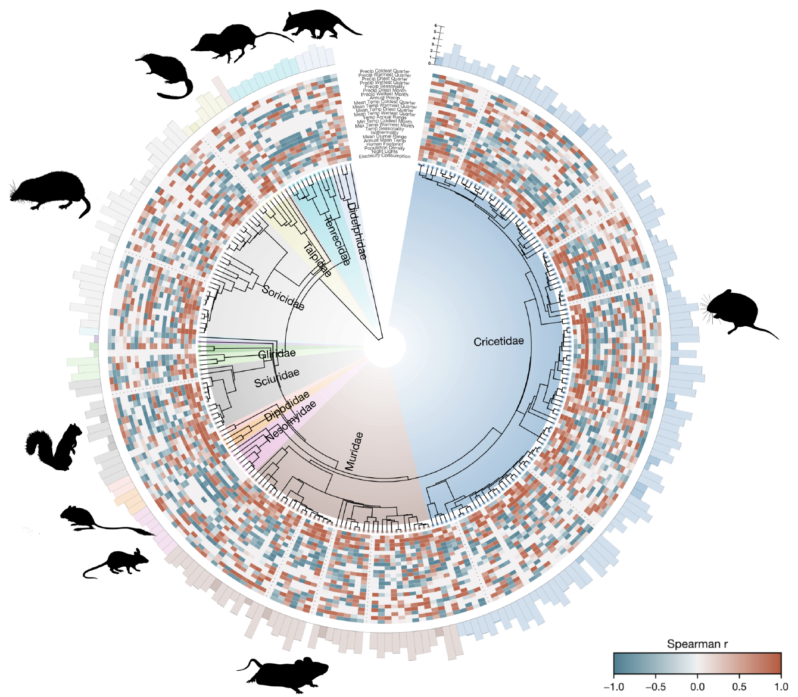{fig-alt="Circular phylogeny of small-mammal host species by family, ringed by heat maps of how each environmental covariate relates to each host's distribution model, with silhouettes of representative species." height="540"}
:::
::::

[Rivero *et al.* 2026, bioRxiv, 10.64898/2026.06.10.731004. Figure 2b, CC BY 4.0.]{.refs}

::: {.notes}
**2 minutes. Section 5 of 7, 9.5 minutes across slides 15 to 17.** *Point to it; don't explain it. Ricardo Rivero and Irene Karegi Akunda are both on the invite list.*

This is Ricardo Rivero's work, with Irene Karegi Akunda, so questions on it go to them.

- **The question.** Segmented viruses can swap segments when two lineages meet in one host. Most of those reassortants disappear. So why do some persist?
- **What they did.** They reconstructed reassortment histories across 553 genomes from seven orthohantavirus species, from 1983 to 2024.
- **What they found.** It varies a lot between viruses. There's none in Andes virus, and it's frequent in Dobrava-Belgrade, Sin Nombre, Seoul, Puumala and Tula. Local host overlap was the strongest ecological factor, and molecular compatibility between segments acts as a filter. Reassortants establish best when both line up: the lineages have to meet in a host, and the segments have to fit.
- **The link to ArHa.** The host overlap came from ArHa's host records and sequence links. That's what let an ecological variable into an evolutionary analysis.
- **The figure.** This is the host side of the analysis: the host phylogeny by family, ringed by environmental and human-footprint covariates. Distribution models for the hosts are what produce the host-overlap surface.

*Figure 2b. Don't read out the rings or the bars. The legend calls the outer bars unitless Spearman correlations, but they carry a 0 to 6 axis, so ask Ricardo what they show before saying more.*
:::

## Lassa virus spillover, revisited
<!-- Slide 16 -->

::::: {.fragment .fade-out fragment-index=2}
:::: {.columns}
::: {.column width="44%"}
::: {.text-small}
- Basinski *et al.* 2021 estimated infections across West Africa
- Using ArHa I could build on their framework to incorporate biotic interactions
- Eskew *et al.* found competition between *Mastomys natalensis* and *Rattus rattus* modifies spillover risk
- *M. natalensis* occurrence modelled within a community of 8 sympatric small-mammal species
- Why no outbreaks in major cities, where the hospitals and laboratories are?
    - Across 32 diseases, outbreak risk peaks in mosaic landscapes, and reporting falls with travel time to care (Gibb *et al.* 2026, *Nature*)
:::
:::
::: {.column width="56%"}
<!-- Figure 1a and 1b cut from the published PDF by scripts/crop_talk_figures.R. Figure 8 replaces them on a key press. -->
::: {.r-stack}
::: {.fragment .fade-out fragment-index=1 .lassa-panels}
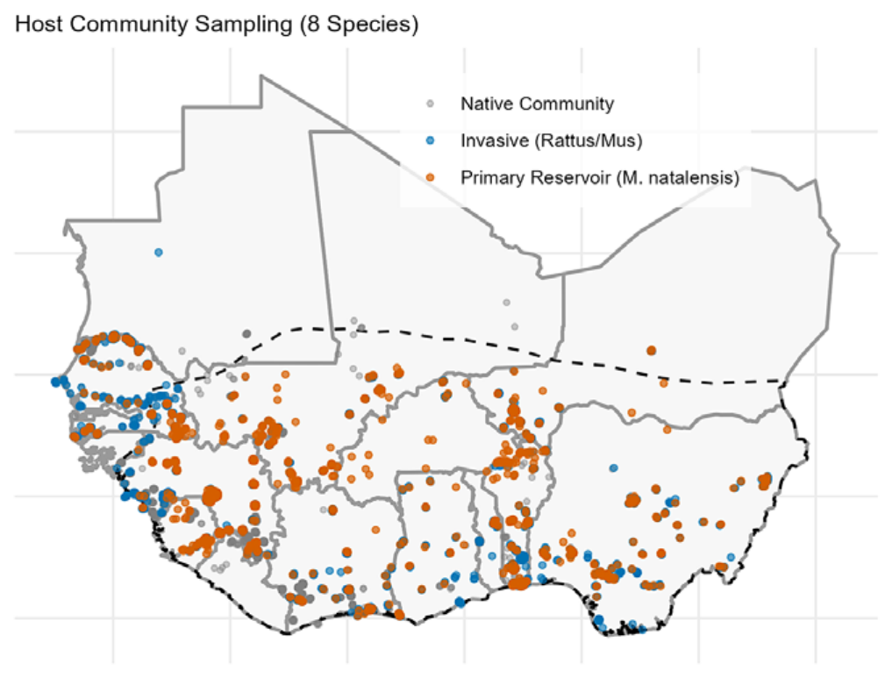{fig-alt="Small-mammal trapping locations across West Africa: Mastomys natalensis, invasive Rattus and Mus, and the native community." height="280"}

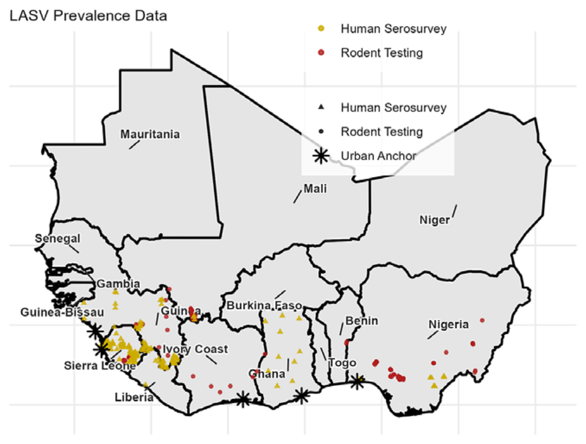{fig-alt="Lassa virus prevalence data: rodent testing sites, human serosurveys and urban absence anchors across West Africa." height="280"}
:::

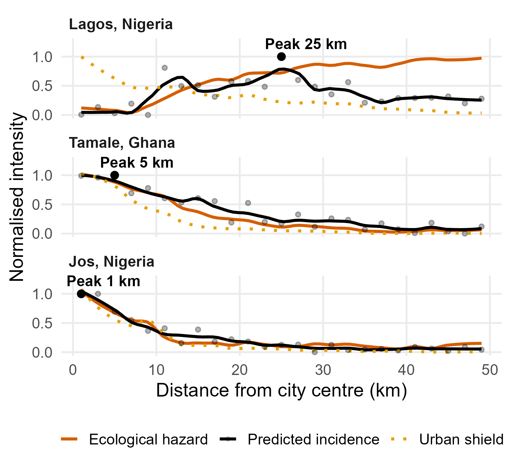{.fragment .fade-in-then-out fragment-index=1 fig-alt="Radial profiles of ecological hazard, predicted incidence and the urban shield from the centres of Lagos, Tamale and Jos. In Lagos hazard rises outward and incidence peaks 25 km out; in Tamale and Jos all three fall from the centre." height="560"}

:::
:::
::::
:::::

::: {.fragment .fade-in fragment-index=2 .radial-full}
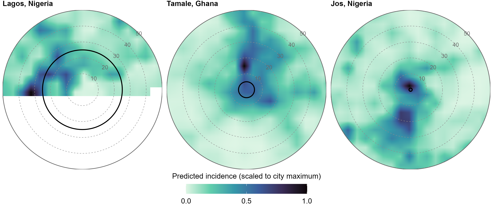{fig-alt="Maps of predicted Lassa fever incidence within 50 km of Lagos, Tamale and Jos, on the same scale for each city. Lagos is half sea, with incidence spread through its hinterland; in Tamale and Jos incidence concentrates near the centre." width="100%"}

[Black circle: distance of maximum predicted incidence. Rings every 10 km.]{.radial-key}
:::

[Spillover framework: Basinski 2021, *PLoS Comput Biol*.\
Socio-economic shield: Simons 2026, *Epidemiol Infect*.]{.refs .refs-narrow}

```{=html}
<style>
.text-small { font-size: 0.5em; }
.text-small li { margin-bottom: 0.4em; }
.refs-narrow { right: 58% !important; }
.lassa-panels p { margin: 0; }
.lassa-panels img { margin: 0 !important; }
.radial-full { position: absolute; top: 120px; left: 0; right: 0; }
.radial-full p { margin: 0; }
.radial-full img { margin: 0 !important; }
.radial-key { display: block; font-size: 0.45em; color: #5f625c; margin-top: 0.6em; }
</style>
```

::: {.notes}
**5 minutes. Part of section 5.**

This updates Basinski and colleagues' 2021 paper, "Bridging the gap", with Scott Nuismer as senior author. It's their framework. The changes are mild: I added biotic interactions through a multi-species model, and many more rodent records from ArHa. So it's an update, not a correction, and I think a nice one.

There are two threads here. First, Evan Eskew and colleagues showed competition between *Rattus* and *Mastomys*, and that interaction has to affect Lassa virus. The multi-species model is how it enters here.

Second, cities. The reservoir can persist in and around cities. Yet major cities don't see human outbreaks, even though that's where the hospitals and laboratories are. Diagnostic capacity is best exactly where cases are absent. So the absence tells us something; it isn't a surveillance gap. The socio-economic shield is my attempt to model it.

What the model finds: the reservoir persists in peri-urban land once co-occurrence with *Rattus rattus* and *Mus musculus* is modelled. A socio-economic shield, proxied by night-time lights, decouples hazard from incidence. After seroreversion and shielding, it estimates roughly 2.6 million infections a year, and it picks out silent districts in Nigeria, Benin and Togo.

*Third key press: the radial maps, full width; the bullets go.*

A city isn't a circle, and a radial profile flattens it. Lagos is half sea, so its profile averages land with water. Jos is far smaller and compact. Even so, the model puts Jos's highest incidence at its centre, where cases would be seen, and still the large cities report no outbreaks. The black circle is the distance of maximum predicted incidence. Each city is scaled to its own maximum, so compare the shape within a city, not the darkness between cities.

*If it fits:* A recent Nature paper by Gibb and colleagues looked at 58,319 outbreak records for 32 diseases, accounting for detection and reporting bias. Risk was typically highest in mosaic landscapes, where people and livestock live alongside forest and fragmented ecosystems. And reporting fell by a median of 32% for each extra hour of travel time from a health facility. Both point the same way as the shield: the peri-urban mosaic carries the risk, and a city is where a case would most likely be seen.

*Present Gibb as the cross-disease pattern; whether Lassa fever is among the 32 is unchecked. The Lassa-specific point rests on my own outbreak record: no major city has been involved in a documented outbreak.*

*In the room: Scott Nuismer, Evan Eskew and Pilar Fernandez are on the invite list; Steph Seifert and Dave Redding are co-authors.*

*Refs: Basinski et al. 2021; Eskew et al. 2024; the shield paper, Epidemiology & Infection, 10.1017/S0950268826101824; Gibb et al. 2026, Nature, 10.1038/s41586-026-11058-6.*
:::

## Rapid response: Andes virus, 2026
<!-- Slide 17 -->

:::: {.columns}
::: {.column width="48%"}
::: {.text-small}
- An outbreak aboard the cruise ship MV Hondius: 11 confirmed cases, 3 deaths
- The index case's public record of their activities was integrated with modelled outputs from ArHa using:
    - Rodent occurrences
    - Antibody prevalence
    - Viral sequences
- Using these three layers we resolved exposure to the southern-Andean focus of *Oligoryzomys longicaudatus*, not the Tierra del Fuego landfill that drew the media attention
:::
:::
::: {.column width="52%"}
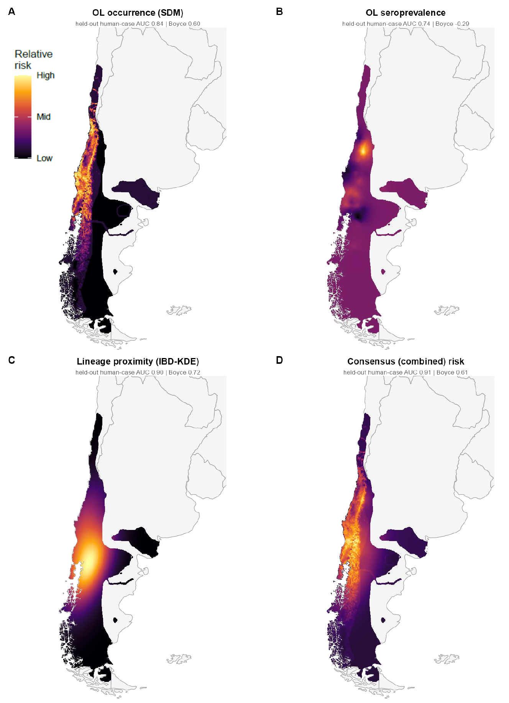{fig-alt="Four maps of Patagonia: reservoir occurrence, reservoir seroprevalence, proximity to the human-transmissible lineage, and their consensus, converging on north-western Patagonia." height="540"}
:::
::::

[Redding *et al.* 2026, medRxiv, 10.64898/2026.09.28.26364179. Figure 4, CC BY 4.0.]{.refs}

::: {.notes}
**2.5 minutes. Part of section 5.**

This is Dave Redding's preprint from the Natural History Museum, posted on 29 September, with Albaladejo-Robles, Nino Barreat, Abbate and me. The point is that open data let the team place the exposure within days, while the public story was about a landfill. That's the outbreak-response use of the dataset.

All three ArHa layers are in play. Panel A is reservoir occurrence, B is reservoir seroprevalence, C is proximity to the human-transmissible lineage from the sequences, and D is their consensus.

Each layer was scored on human cases it hadn't seen. The AUC is the chance that a place where a human case arose ranks above a background location. Occurrence alone gives 0.84, seroprevalence 0.74, lineage proximity 0.90, and the consensus 0.91. So each ArHa layer predicts on its own where people were infected. The sequences carry the most, and combining them adds little over the sequences but loses nothing.

*The numbers are too small to read on the slide, so say them.*

*If asked: the Boyce index, the other figure in each subtitle, is 0.60, −0.29, 0.72 and 0.61. Seroprevalence ranks cases well (AUC), but its predicted high-value areas don't hold proportionally more cases (negative Boyce). Check how many held-out cases the AUCs rest on before quoting them with confidence; with few cases the intervals will be wide.*

*Figure cut from page 42 of the preprint as a placeholder.*
:::

# What next
<!-- Slide 18 -->

## Optimising sampling for surveillance
<!-- Slide 19 -->

:::: {.columns}
::: {.column width="40%"}
::: {.text-small}
- Host distribution models give a biodiversity dose: where the hosts of a pathogen are likely to be
- Uncertainty in those models shows where occurrence sampling would teach us most
- A priority score balances discovery sampling against prevalence sampling where dose is high
- Balanced-acceptance sampling spreads sites out, rather than clustering them in one hot spot
- I am operationalising this with Chungnam National University, South Korea, for hantaviruses and scrub typhus
:::
:::
::: {.column width="60%"}
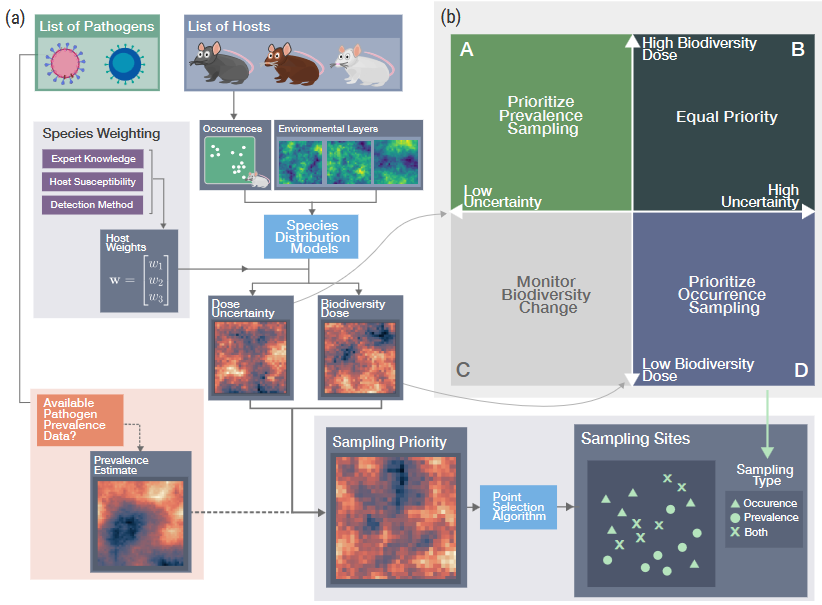{fig-alt="Framework for setting surveillance sampling priority. Host lists and occurrences feed species distribution models, giving a biodiversity dose and its uncertainty; these set a sampling priority and spatially balanced sampling sites, with the choice between prevalence and occurrence sampling set by dose and uncertainty."}
:::
::::

[Catchen *et al.* 2026, *PLOS Ecosystems*, 10.1371/journal.pesy.0000023.]{.refs}

::: {.notes}
**5 minutes. Section 6 of 7, 7.5 minutes across slides 19 and 20.**

Next, where to sample. Our biodiversity-informed surveillance protocol is out in PLOS Ecosystems. Host distribution models give a biodiversity dose. The uncertainty in those models shows where discovery sampling would help most. Then balanced-acceptance sampling places the sites. We worked through case studies on hantaviruses and arenaviruses in India, which is data-poor, and South Korea, which is data-rich.

That leads into a new Vetenskapsrådet grant, South Korea–Sweden, running from this month to December 2027, with Chungnam National University. We'll use landscape embeddings, Bayesian downscaling to human incidence, and active learning to direct rodent sampling. We'll apply it to hantaviruses and to scrub typhus, *Orientia tsutsugamushi*, which is carried by chigger mites that feed on rodents.

*Public facts only; the application is unpublished. Protocol: 10.1371/journal.pesy.0000023.*
:::

## Pest control as surveillance
<!-- Slide 20 -->

::: {style="font-size: 0.75em;"}
- ArHa is built from the literature, so it samples where researchers go. Swedish records are thin and come from research trapping, not from the places people meet rodents
- Pest controllers and the public already record rodents in those places. **A catch list is a hazard list**: the traits that make a species a pest, fast breeding, a generalist diet and tolerance of people, are the traits that predict reservoir status
- Next: bring pest-control and citizen-science records into ArHa's structure of sampling events, host occurrences and pathogen results, giving a national infestation surface and a first urban rat pathogen baseline for *Leptospira* and Seoul orthohantavirus
- Wider: ArHa grows beyond arenaviruses and hantaviruses to rodent-borne zoonoses, v1 gets updated, and what we learnt building it carries forward

CASCADE, funded by Formas, 2026; led by Hussein Khalil, SLU.
:::

::: {.notes}
**2.5 minutes. Part of section 6.**

This slide is about ArHa's next step. The literature won't fill the gaps on the globe by itself. So the work now is finding data that already exist outside the literature, and fitting them to the same structure. Sweden is the test case.

Here's the link back to the macroecology. If the traits that make a species a pest also predict reservoir status, then pest-control records are hazard data that already exist, and they're collected where people and rodents meet. The outcome we'll link them to is nephropathia epidemica, Puumala orthohantavirus infection, with hundreds of cases a year in Sweden.

And CASCADE takes ArHa itself further. We'll go beyond arenaviruses and hantaviruses and start compiling records for rodent-borne zoonoses more widely. We'll update version 1 of ArHa along the way, and carry forward what we learnt from building it.

CASCADE was funded by Formas today. It's led by Hussein Khalil at SLU, and I lead the modelling work package.

*Don't name the corporate partner or describe partner discussions. If asked, CASCADE stands for Climate-Amplified Spillover, Connecting Acute and gradual Drivers of Emerging vector-borne and zoonotic diseases in Sweden.*
:::

## {#use-it .center}
<!-- Slide 21 -->

<style>
.use-it-big { font-family: "Newsreader Variable", Georgia, serif; font-size: 2.5em; font-weight: 600; line-height: 1.1; }
#use-it .columns { display: flex !important; align-items: center !important; }
</style>

:::: {.columns}
::: {.column width="35%"}
[Use it]{.use-it-big}
:::
::: {.column width="65%"}
- Open, versioned and citable: **doi.org/10.5281/zenodo.21978982**
- Parquet tables for analysis, an explorer app for browsing
- Non-detections and sampling effort included
- Data paper in preparation, publicly available: [link]{.placeholder}
:::
::::

## Data get used in ways nobody planned
<!-- Slide 22 -->

<style>
.pharos-col { text-align: center; font-size: 0.6em; }
#data-get-used-in-ways-nobody-planned .columns { display: flex !important; align-items: center !important; }
</style>

:::: {.columns}
::: {.column width="64%"}
::: {style="font-size: 0.75em;"}
- The Andes attribution drew on rodent surveys collected over decades, for other questions
- Each of the 728 studies in ArHa was designed for its own question, not necessarily the ones we have used it for
- Sharing openly is how that happens, rather than waiting for a collaboration request
- Share yours in a shared format: the minimum data standard means the harmonisation is done once, at source
:::
:::
::: {.column width="36%" .pharos-col}
<a href="https://pharos.viralemergence.org/" style="display:inline-block; background:#1e2420; border-radius:8px; padding:14px 22px; line-height:0;"></a>

Pharos hosts data in this format\
**pharos.viralemergence.org**
:::
::::

[Minimum data standard: Schwantes *et al.* 2025, *Scientific Data*, 10.1038/s41597-025-05332-x.]{.refs}

::: {.notes}
**5 minutes across these two slides. Section 7 of 7: the call to action.** *Keep it light; this isn't a soapbox for open science. The examples in the talk make the case, so point back to them rather than argue it. First slide: how to get it and cite it. Second slide: the point.*

So my ask is simple. Use your data, and adopt open practices for the future. You never know how others will use your data, in ways you'd never have planned yourself. Waiting for someone to ask for a collaboration is a bit old school.

If you cite ArHa, please use the concept DOI. It always resolves to the latest version.

*Concept DOI 10.5281/zenodo.21978982; v1.1 is 10.5281/zenodo.21978983.*

*Before the talk:*

- *Placeholder: where the data paper draft is publicly available. It isn't in the ArHa GitHub repository (the manuscript folder is not tracked there).*
- *The ArHa README still names the January database as latest and carries no DOI. People will land there tomorrow, so update it first.*
- *Wake the explorer: https://diddrog11.shinyapps.io/ArHa_Database_Explorer/ (free-tier hosting).*
:::

## Thank you {.center}
<!-- Slide 23 -->

:::: {.columns style="font-size: 0.75em;"}
::: {.column width="50%"}
**The Project ArHa team**

- Steph Seifert
- Ricardo Rivero
- Grant Rickard
- Harry Gordon
- Ana Guiote
- Greg Milne
- Dave Redding
:::
::: {.column width="50%"}
**Funding**

- Verena consortium, Fellows‑in‑Residence programme
- Sagan Friant and the SCAPES team, Penn State

**Data**

- Every team whose study is in ArHa
:::
::::

[David Simons, Uppsala University]{.refs}

::: {.notes}
Thank you. I'm happy to take questions.

*About 15 minutes of the hour for questions.*
:::
