# Why this project {background-color="#f4f4f4"}

## Surveillance is reactive, so our data are biased

:::: {.columns}
::: {.column width="55%"}
- Rodents are mostly sampled after outbreaks, or where trapping is convenient
- Models trained on these data learn where people looked, not only where the hazard is
- The project treats surveillance as a question of where new data would reduce uncertainty most
:::
::: {.column width="45%"}
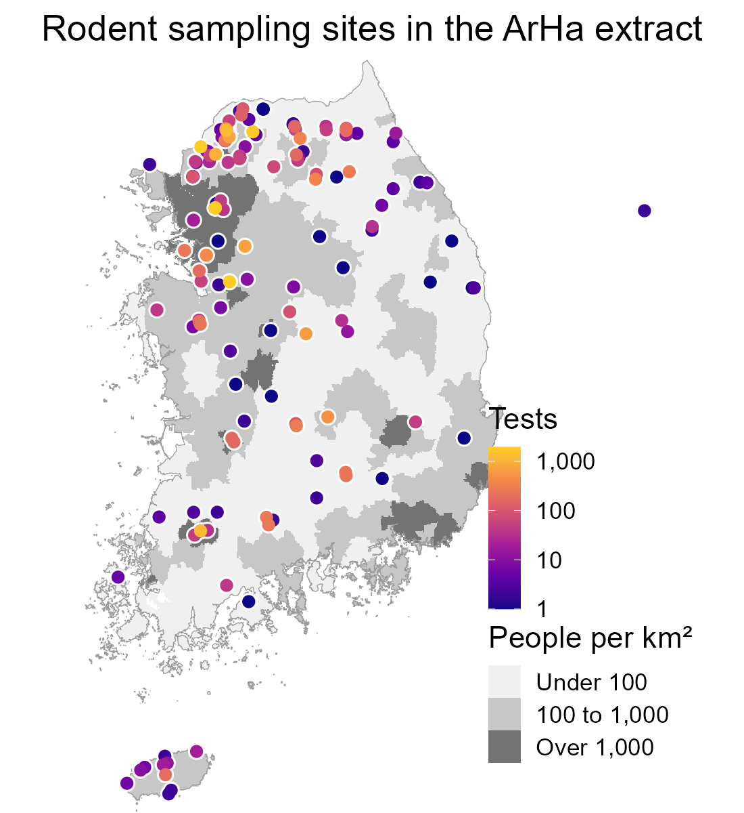
:::
::::

::: notes
I'll start with the problem. Most rodent sampling happens after an outbreak, or wherever it's convenient to set traps.

This map shows every site in our current ArHa extract for South Korea, coloured by how many animals were tested, on top of population density. Most of the sampling is in the north-west, up by the DMZ around Paju and Yeoncheon. That's where Hantaan virus was first described, and where soldiers have been the classic risk group. There's very little in the south-east, around Busan and Daegu.

That could mean the hazard is lower there, or it could mean nobody has looked. A model trained on these data can't tell the difference, so part of what it learns is where people went looking. That's why the project treats surveillance as a question of where new data would teach us most.

One caveat: this extract predates our update, which adds studies since 2023 and Korean-language papers, so the picture may change.

If asked: one extract row (R. norvegicus, Seoul virus, 88 tested) sits at 41.4 N in North Korea and is off the map; to check against the source paper. Ref: Simons et al. 2023, PLoS NTD.
:::

## The pipeline on one slide

:::: {.columns style="display: flex; align-items: flex-end;"}
::: {.column width="31%"}
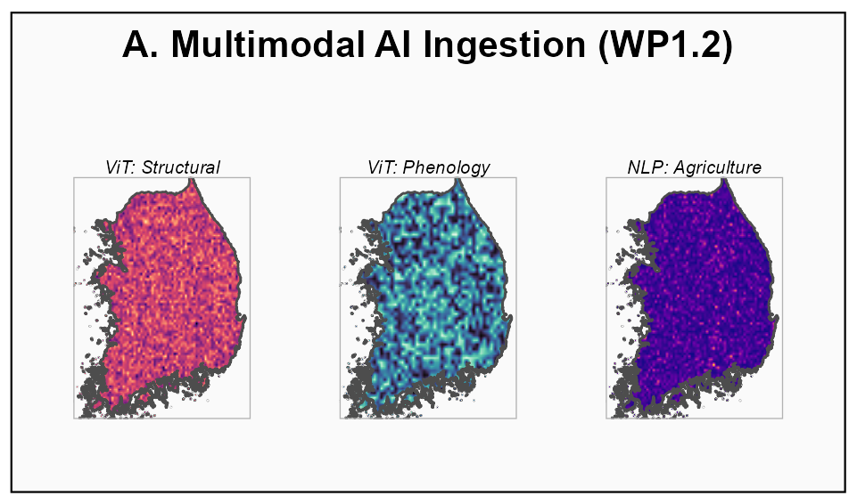
:::
::: {.column width="23%"}
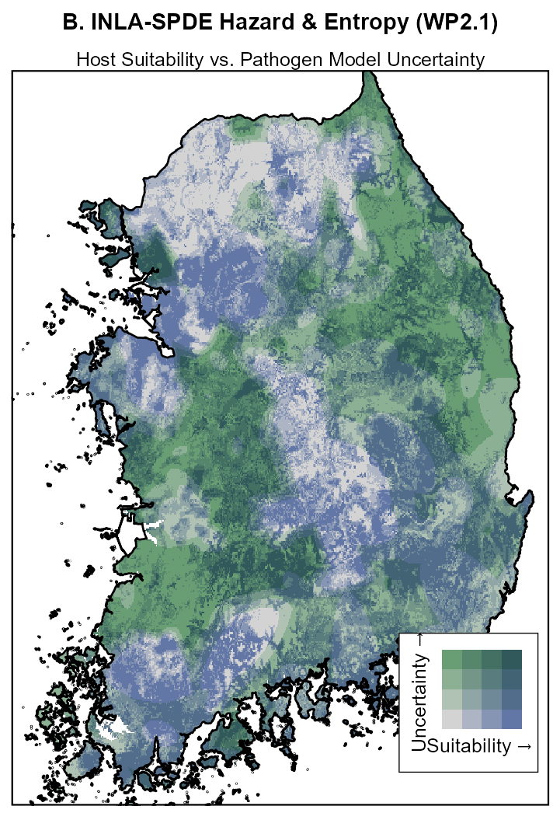
:::
::: {.column width="23%"}
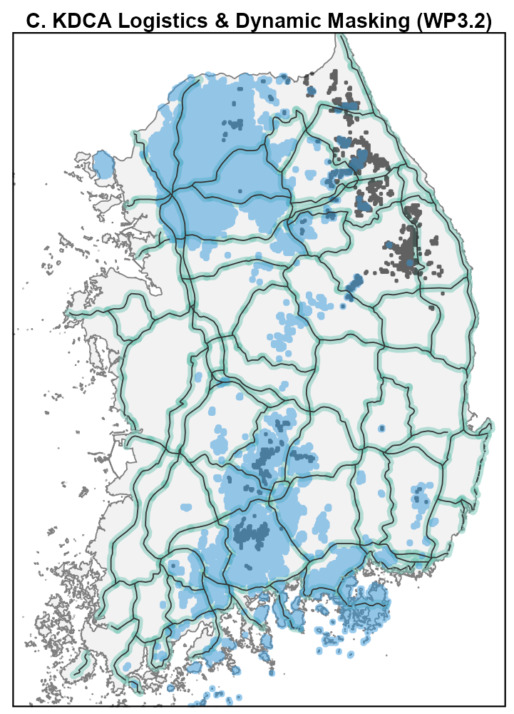
:::
::: {.column width="23%"}
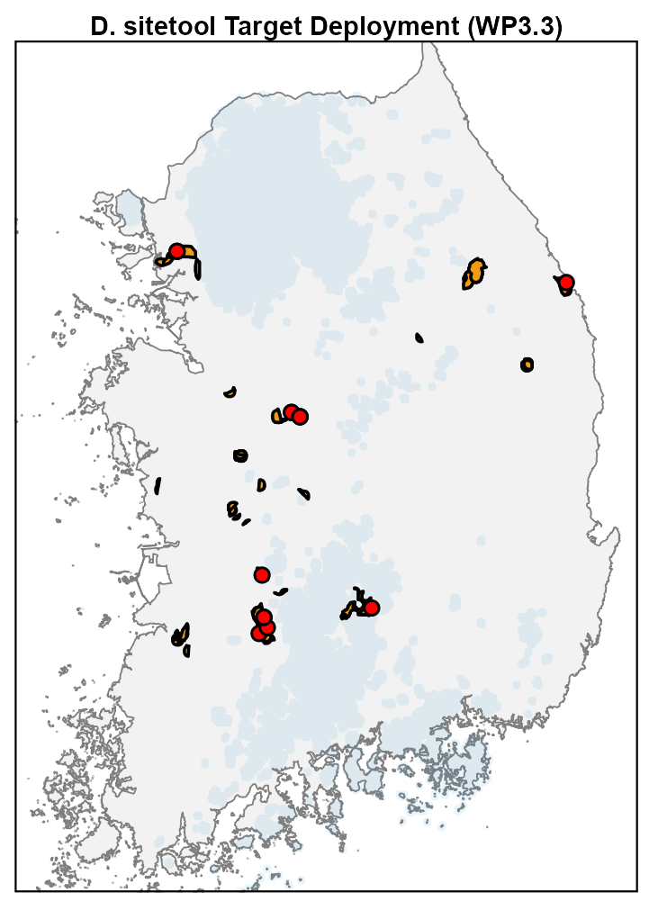
:::
::::

:::: {.columns style="text-align: center; font-size: 0.75em;"}
::: {.column width="31%"}
1\. Landscape features from satellites
:::
::: {.column width="23%"}
2\. Hazard and how sure we are
:::
::: {.column width="23%"}
3\. Where teams can reach
:::
::: {.column width="23%"}
4\. Where to sample next
:::
::::

::: notes
This is the whole project on one slide, left to right.

We start with landscape features from satellites, that's WP1.1. We use those to model where the hosts are and where the virus circulates in them, WP1.2 and 1.3, and combine them into a hazard index. WP2 links that hazard to the KDCA case data at district level. WP3 downscales it to a fine grid with uncertainty, and then uses the uncertainty to choose where to sample next.

The figure is from the application, so the panels are simulated; it's only there to show the flow. In the first panel, the two ViT maps aren't separate models: they stand for different aspects, structure and seasonal change, that end up as different numbers in the same embedding. The third map was a text-mining layer, picking up reports of rodents in news or social media. We'd rather first see whether we can get rodent activity data from pest-control companies; the text-mining idea is on hold rather than ruled out. Today I'll focus on the two ends: the satellite features, and choosing where to sample.
:::

# Part A: landscape features from satellites {background-color="#f4f4f4"}

## Before transformers: bands and indices {.smaller}

- Glass et al. 2000: three Landsat bands plus elevation, from the year before the 1993 outbreak, retrospectively identified hantavirus pulmonary syndrome case sites
- A model using only the vegetation index (NDVI) fitted poorly in that sparse, semi-arid landscape
- Rich spectral information carries more than any single index

:::: {.columns}
::: {.column width="50%"}
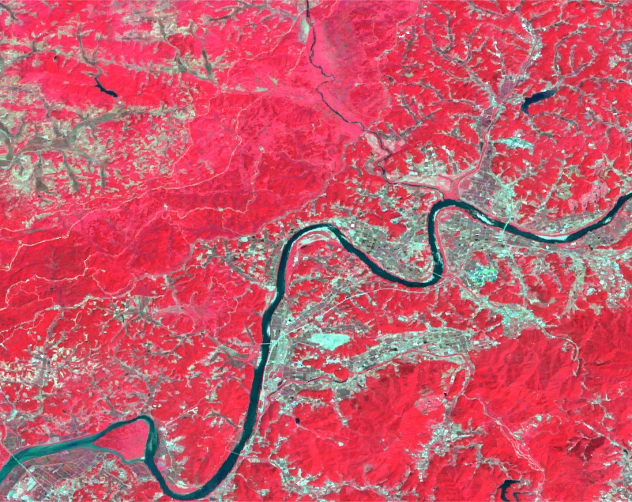{height="300"}
:::
::: {.column width="50%"}
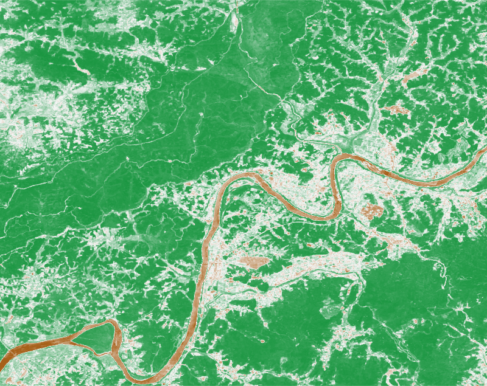{height="300"}
:::
::::

::: notes
Using satellites for hantavirus isn't new. Glass and colleagues took Landsat images from the year before the 1993 hantavirus pulmonary syndrome outbreak in the US, and with three bands plus elevation they could pick out, looking back, where the cases had come from. At their threshold they kept 95% of case sites and ruled out 62% of controls. A model with only NDVI, the vegetation index, did badly. Reducing the entire spectral picture to a single index throws away a substantial amount of information.

That was a dry, sparsely vegetated landscape, where NDVI struggles with bare ground. Korea has the opposite problem: it's so green that NDVI saturates, which we'll see in a couple of slides. Different reason, same lesson.

The forward test came two years later. They used the risk maps to choose 38 trapping sites, with field crews blind to the predictions. In the second year, infected deer mice turned up at 18 of 20 high-risk sites but only 1 of 11 low-risk ones.

You can see why a single index loses information here. This is 20 km around the Paju trapping site, summer 2024. On the left is false colour: forest is dark red, fields are lighter, villages and roads are blue-grey. On the right is NDVI from the same images, and forest and fields both just look green. The false colour is only to show what the bands carry; it isn't the combination their model used, which was blue and two mid-infrared bands.

If asked about controls: they were clinic patients' households without HPS, not tested for antibodies in this study; the paper cites an earlier study that found no subclinical infection among controls. The 2002 trapping found no high/low difference in the first year (1998), only in 1999.

Refs: Glass et al. 2000, Emerg Infect Dis 6(3): 238 to 247 (threshold 0.10; 28 cases, 170 controls; 30 m pixels, 3 x 3 window at each household). Glass et al. 2002, PNAS 99(26): 16817 to 16822. Images: Landsat 8 and 9, May to September 2024 cloud-free median; representations.py.
:::

## What a vision transformer is {.smaller}

- The image is cut into small patches, like words in a sentence
- Each patch becomes a vector of many numbers from all its bands, so two forests no longer share one label
- Attention updates each patch using every other patch, so the same river differs next to fields or in forest
- The output is one vector per pixel: a learned summary of the place and its surroundings

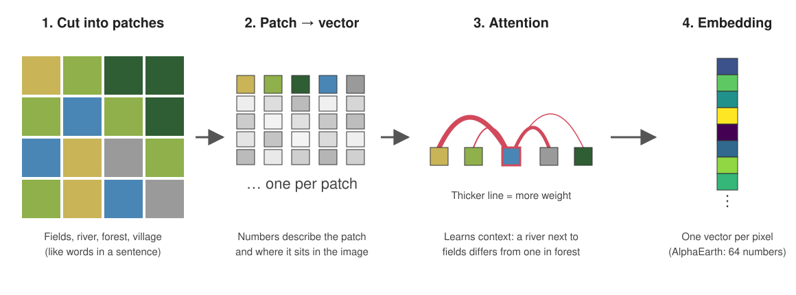{fig-align="center" height="350"}

::: notes
So what's a vision transformer? It's the same idea as the language models. You cut the image into patches, treat each patch like a word, and turn each one into a list of numbers, built from every pixel in every band of that patch.

That gives us detail in two ways. First, many numbers instead of one label: two forests that a land-cover map calls the same thing get different vectors. Second, attention. Each patch looks at every other patch and decides how much weight to give it, and its vector is updated with that context. So a river running past fields ends up different from a river through forest.

If you think of the buffers we use in ecology, summarising land cover within a kilometre of a site, attention is a bit like that, except the model learns the weights itself and isn't tied to distance.

What comes out at the end is one vector per pixel. For AlphaEarth, that's 64 numbers for every 10 m pixel. You can think of them a bit like PCA scores: coordinates where similar places sit close together. The individual numbers don't mean anything on their own. The diagram is simplified: real models use hundreds of patches and much longer vectors, and AlphaEarth also combines several sensors over a year, but the idea is the same.

If asked: resolution comes from the sensor (Landsat 30 m, Sentinel-2 10 m); the model takes a fixed number of pixels (often 224 x 224). Patch size (often 16 x 16) is a design choice: smaller patches keep detail but cost grows with the square of the number of patches. Convolutional networks slide a small window and only see further by stacking layers; a transformer relates any two patches in one step.

Ref: Dosovitskiy et al. 2020, "An image is worth 16x16 words" (cited in the Korean proposal).
:::

## Pretraining: learn the landscape before the task

- Foundation models are trained on millions of unlabelled satellite images
- Masked autoencoding: hide most of each image and learn to reconstruct it
- Prithvi-EO-2.0: 4.2 million global samples, 30 m, six bands, four dates each

::: notes
What makes these models useful to us is pretraining. A model like this has hundreds of millions of weights, and they all start out random. To learn them you need a task with known answers, and labels are scarce. So you make the task out of the images themselves: hide most of each image and ask the model to fill in the rest. To do that well it has to learn what landscapes are like: fields have edges, rivers continue, forests green up in spring. Prithvi, for example, was trained this way on 4.2 million samples from around the world.

A model trained from scratch has to learn everything, from basic textures upwards, from its labelled examples. A pretrained model already has the basics and only has to adjust. We'll only ever have a few hundred labelled rodent sites, so we borrow what the model has already learned.

For me, Prithvi vs AlphaEarth (mention only if it comes up; the comparison slide is two slides on):
- Who and what we get: Prithvi is from NASA and IBM, and the weights are open, so we run it on images and dates we choose, and can fine-tune it. AlphaEarth is from Google DeepMind; only the finished annual maps are released, not the model.
- Inputs: Prithvi uses six optical bands from Harmonized Landsat Sentinel-2 at 30 m, as a short time series (four dates). AlphaEarth takes Sentinel-2, Landsat and Sentinel-1 radar, and during training was also asked to predict lidar canopy height, elevation, climate, gravity data and text from Wikipedia and GBIF records. That is why the GBIF circularity point comes up later.
- Pretraining task: Prithvi is a masked autoencoder (hide patches, reconstruct them). AlphaEarth reconstructs all those sources, matches the text, and is pushed to spread its embeddings evenly.
- Architecture: Prithvi is a ViT. AlphaEarth mixes spatial attention, attention over time and small convolutions, so it is a ViT relative rather than a plain one.
- Output: AlphaEarth gives 64 numbers per 10 m pixel per year (2017 onward). Prithvi gives a much longer vector per patch, which we would summarise ourselves.

If asked whether pretraining really helps with a few thousand labels: Le et al. fine-tuned ImageNet models (everyday photographs, not satellite images) on the RGB bands of EuroSAT (27,000 Sentinel-2 images, 10 land-use classes). Most pretrained models reached 96 to 99%, against 93.9% for the best from-scratch model (a ResNet) and 92.6% for the best from-scratch transformer; one pretrained model (Vision-xLSTM) did worse, at 85.8%. So pretraining even on photos mostly helps, but it doesn't test satellite pretraining. ViTs need more data than convolutional networks because they assume less about images (Dosovitskiy et al. 2020 found ViTs only beat CNNs when pretrained on 14 million or more images).

Refs: Szwarcman et al. 2026, IEEE TGRS 64: 4400120. Le et al. 2026, arXiv:2409.03901. Brown et al. 2025, arXiv:2507.22291 (AlphaEarth: inputs Table S1; about 480 million parameter model released as embeddings only).
:::

## What an embedding is

:::: {.columns}
::: {.column width="50%"}
- AlphaEarth Foundations: 64 numbers for every 10 m pixel, one layer per year, 2017 to 2025
- The numbers summarise what the landscape looks like across sensors and seasons
- Similar landscapes have similar embeddings, whatever their land-cover label
:::
::: {.column width="50%"}
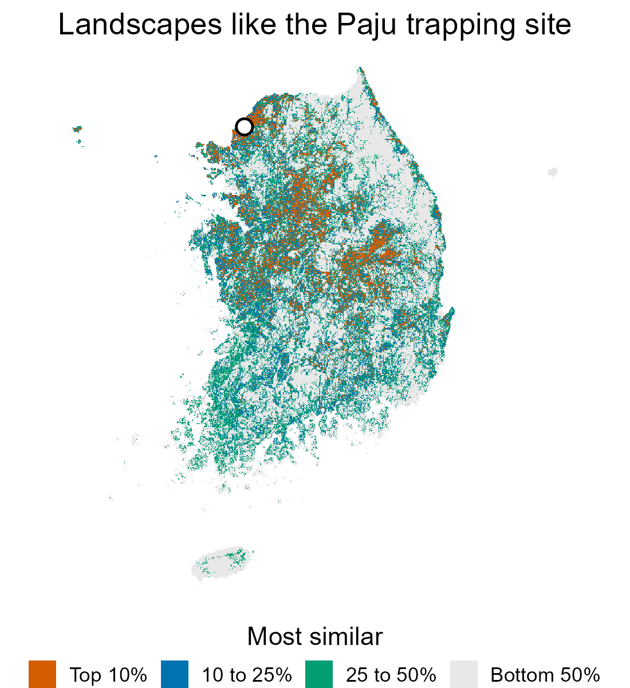{height="560"}
:::
::::

::: notes
AlphaEarth gives us 64 numbers for every 10 m pixel, one layer per year from 2017 to 2025. You can think of them as a summary of what a place looks like across sensors and seasons. Places that look alike get similar numbers, whatever label a land-cover map gives them.

Here's one way to see that. I took the average embedding within a kilometre of our Paju site, the white dot. That's the site with the most Hantaan-positive striped field mice in our data, 381 out of 1,710. Then I ranked every 500 m cell in the country by how similar it is; orange is the most similar 10%. Some of those places wouldn't look alike to us in a single photo, but across sensors and the seasons of a year the model sees them as close.

One thing to be clear about: this is similar to Paju, not similar in risk. Paju is just the reference point. The map says nothing yet about rodents or virus; that link only comes when we fit the embeddings to trapping data.

If asked: the score is cosine similarity between 64-number vectors; most of the country scores 0.5 to 0.9 because land embeddings sit close together, so there is no natural cut-off and the map shows rank instead. The reference is a 1 km average, about half cropland and a third tree cover, so no single cell matches it exactly.

Refs: Brown et al. 2025, arXiv:2507.22291. Earth Engine GOOGLE_SATELLITE_EMBEDDING_V1_ANNUAL, 2024 layer, cosine similarity, binned by percentile across South Korea; embedding_similarity.py.
:::

## What the similar places are made of {.smaller}

:::: {.columns}
::: {.column width="38%"}
- The more similar to Paju, the more cropland and the less forest
- Half the top 10% are crop and forest mosaics like Paju, against 5% of the bottom half
- Yet the top 10% is still half tree cover on average: similar is not just "more fields"
:::
::: {.column width="62%"}
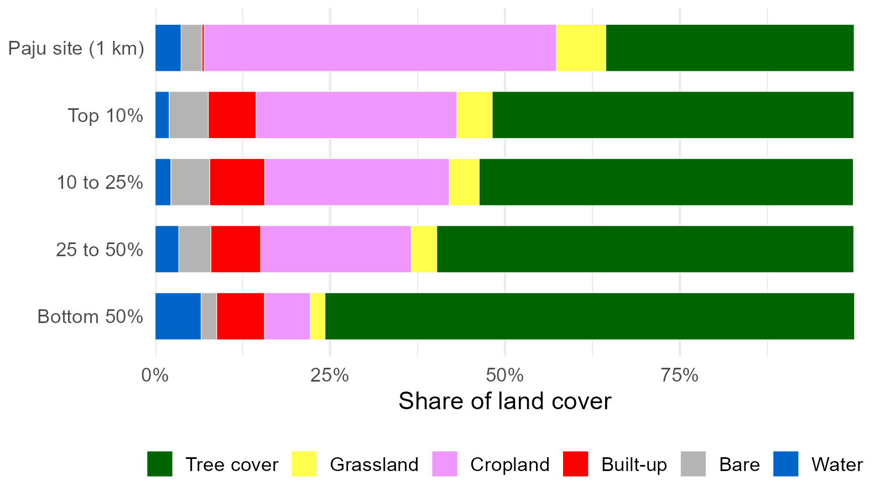{width="100%"}

::: {style="font-size: 0.7em;"}
Average land cover of the cells in each similarity band. ESA WorldCover 2020
:::
:::
::::

::: notes
So what are these similar places? I checked them against the ESA WorldCover land-cover map. Each bar is the average land cover of the cells in one band, with the 1 km around Paju at the top.

Paju itself is about half cropland and a third tree cover. As you move up from the least similar band to the most similar, cropland goes up and forest goes down. About half the cells in the top 10% are a mix of fields and forest like Paju, with at least a fifth of each, against 5% in the bottom half.

But the top band is still half tree cover on average. So the embedding isn't just counting fields: two places with quite different land-cover mixes can still look alike to it. That's the point of the next slide, comparing land cover, NDVI and embeddings directly.

If asked: there are two readings of why the top band isn't closer to Paju's mix. One is that the embedding responds to things the land-cover classes don't capture, such as field size, edges, terrain or how the landscape changes over the year. The other is measurement: WorldCover is 2020 and the embeddings 2024, and the land-cover fractions are at about 1 km while the similarity is at 500 m, so some mismatch is expected. Comparing at 10 m, with the same year, would separate them. Built-up is about 7% in every band but near zero at Paju; bare in the top bands is probably tidal flats on the west coast (not checked).

Refs: ESA WorldCover 2020 via geodata::landcover (fraction of each 30 arc-second cell); crop-forest mosaic = at least 20% cropland and 20% tree cover. figures.R.
:::

## Three ways to describe the same cell {.smaller}

:::: {.columns}
::: {.column width="30%"}
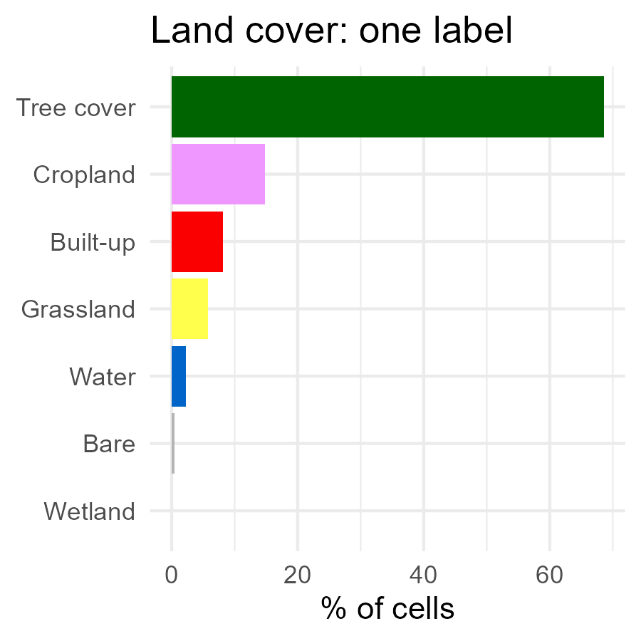
:::
::: {.column width="30%"}
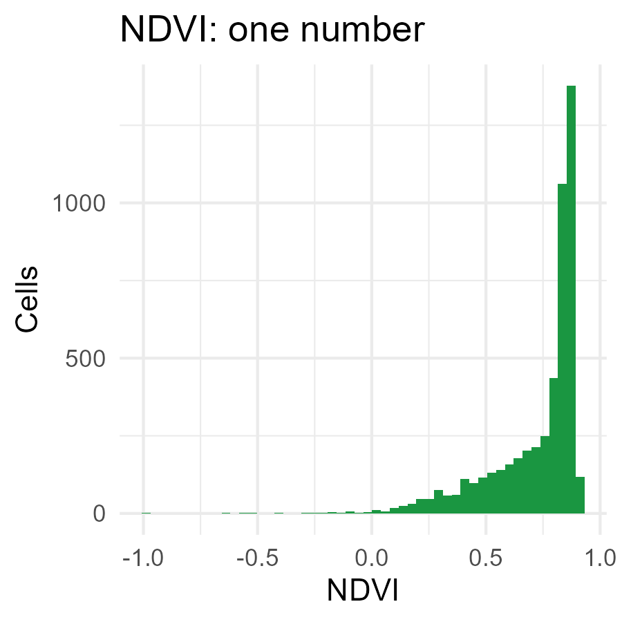
:::
::: {.column width="40%"}
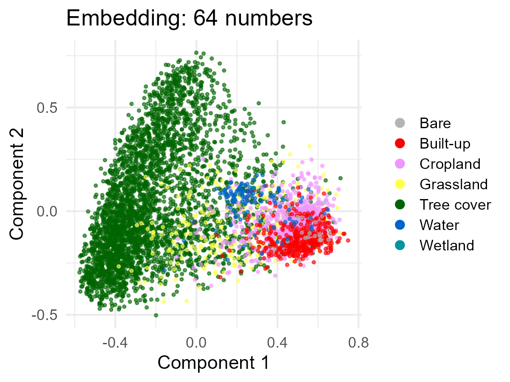
:::
::::

- A label puts two-thirds of the country in one box (tree cover)
- NDVI puts over half the cells between 0.8 and 0.9, where it saturates
- The embedding keeps differences within a class, so a model can learn which of them matter for rodents
- Whether that predicts better is something we test, not assume (comparison with standard covariates)

::: notes
To make that concrete, here are the same five thousand random points across South Korea, described three ways.

On the left, a land-cover map gives each point a label. Two-thirds of the country is just "tree cover", and there are only a handful of classes, so there's very little variation to work with. Splitting classes into subclasses helps a bit, but not much.

In the middle, NDVI gives each point one continuous number, which sounds better. But more than half the points sit between 0.8 and 0.9. That's where NDVI saturates: dense forest and dense crops all read about the same, so the small differences left mostly don't tell you anything ecological.

On the right are the embeddings, squashed onto two dimensions so we can plot them, and coloured by the same land-cover classes. These two are only part of the picture; there are 64 numbers behind each point. Even here, the tree-cover points spread right out, and so do classes you'd expect to be fairly uniform, like water and built-up.

So the embedding keeps differences within a class, and a model can learn which of them matter for rodents. Whether those differences are meaningful is the real question, and it's the last point on the slide.

Two caveats. Some of that spread could be the 2021 land-cover labels being out of date by 2024, rather than real differences. And more numbers per cell means more room to overfit when we have relatively few trapping sites, which is why the plan includes reducing the dimensions.

If asked: 4,997 points, each a 30 m cell; tree cover 69%, cropland 15%; 55% of NDVI values between 0.8 and 0.9. The two components shown hold 40% of the variation in the 64 numbers (ten components hold 83%), and they're a linear view, so classes that overlap here may still separate in the full embedding. Spread within water or built-up could be real (river, reservoir, coast; city, village, greenhouses), mixed cells at land-water and urban edges, or labels that are wrong or out of date. Sources: ESA WorldCover 2021; Landsat 8 and 9 NDVI, May to September 2024 median; AlphaEarth 2024; representations.py and figures.R.
:::

## Our plan: both, in parallel {.smaller}

| | AlphaEarth (pre-computed) | Prithvi-EO-2.0 (open weights, we run it) |
|---|---|---|
| What we get | Ready map, 10 m, annual | Model weights |
| Work for us | Download and summarise | Choose dates, run the model over Korea |
| Time coverage | 2017 to 2025 | Any date with imagery (2013 onward) |
| Seasonal detail | No | Possible |
| Compute | Low | GPU |
| Role | Builds the pipeline now | Explored alongside, with other multi-sensor models |

::: notes
We're not developing our own vision transformer; that was clear in the application. We're applying models others have built, and there are two ways to do that.

One is pre-computed embeddings like AlphaEarth: Google has already run the model, and we download a map. It's ready now, so we build the pipeline on it. It's annual, so any seasonal signal has to come from other covariates alongside it.

The other is an open-weights model like Prithvi, which we run ourselves on dates we choose. That gives seasonal embeddings and goes back before 2017, so it also covers our missing 2016. It costs GPU time and more work on the imagery, especially with cloud during the monsoon. So we explore it in parallel, along with other models that take more than one sensor, rather than waiting on it.

The pipeline takes any set of features per grid cell, so we can swap or add embeddings without redoing the later steps.

If asked about compute: the 300M-parameter Prithvi model should run over South Korea in minutes per time step on one A100 (NAISS, Alvis); an estimate, not yet tested.
:::

## Practical issues for us

- No layer for 2016, the first year of the hindcast training period (2016 to 2023)
- About 10,000 pixels per 1 km cell: how do we summarise them?
- Annual layers only, so no seasonal signal
- The 64 dimensions have no individual ecological meaning
- GBIF records helped train the model, so GBIF-based validation may reward recording effort; we validate on trapping data

::: notes
There are some practical issues. The main one is that AlphaEarth starts in 2017, but our hindcast training period starts in 2016, so we're missing a year. The 2025 layer is there for the whole of South Korea; I checked.

There are about 10,000 pixels in each 1 km cell, so we have to decide how to summarise them. The layers are annual, so there's no seasonal signal. The 64 numbers don't mean anything individually, which makes interpretation harder. And GBIF records were used in training. Rodents are a tiny share of GBIF, so a rodent signal is probably faint. The bigger worry is that GBIF records cluster where people go, near roads, towns and parks, so the embedding may partly carry recording effort. A model checked against GBIF could then look better than it is, so we validate on trapping data instead.

If asked how we'll check: see whether AlphaEarth's released training sites fall in South Korea or near our GBIF records, and whether the embedding predicts GBIF record density beyond land cover and distance to roads.

Check of 2025 layer: 26 October 2026, all 17 tiles over South Korea present, as for 2017 to 2024.
:::

## How embeddings enter our models

- Covariates in the host occupancy models (where rodents are)
- Covariates in the pathogen suitability models (where the virus circulates in them)
- Host and pathogen layers combined into the Ecological Hazard Index
- Same structure as Basinski et al. 2021 and Simons 2026, with richer landscape inputs
- To decide: reduce the 64 numbers first (PCA or similar), or keep them all and shrink them in the model

::: notes
So how do they actually get used? As covariates: in the host models, for where the rodents are, and in the pathogen models, for where the virus circulates in them. Those combine into the Ecological Hazard Index.

It's the same structure as Basinski and colleagues and my 2026 paper, just with richer landscape inputs. And we keep hazard, which is WP1, separate from human exposure, which is WP2.

One thing we need to decide as a team. Sixty-four numbers per cell against a few hundred trapping sites is a recipe for overfitting. We can either reduce them first, for example with PCA across all of Korea so the reduction never sees the trapping data, or keep them all and let the model shrink the ones that don't help. Our aim is prediction with honest uncertainty, not explaining which covariate does what, so the fact that embeddings overlap with climate and elevation matters less than it would in an explanatory model.

If asked: ten principal components hold 83% of the variation in our 5,000-point sample, but variance explained is the wrong guide to how many to keep. In a simulated dry run of the pipeline, a set of components holding 81% of the variance recovered less of the true host surface than plain land cover did, because the leading components are dominated by what the embedding shares with ordinary covariates while the distinguishing signal sits much further down the ordering. Simulated, so not evidence about AlphaEarth itself, but enough to say that selecting components by a scree plot selects against the reason for using an embedding. We will set the number by predictive performance under spatial block cross-validation, or regularise the full 64 rather than reduce at all. AlphaEarth was trained to predict climate, elevation and canopy height, so it overlaps with those covariates; if we ever need interpretable climate effects, we can regress the embeddings on climate and use the residuals. Embeddings and the spatial random effects in BYM2/SPDE will also compete for the same smooth spatial pattern, which can distort the uncertainty. Evaluation is by spatial cross-validation.

Refs: Basinski et al. 2021, PLoS Comp Biol; Simons 2026, Epidemiol Infect.
:::

# Part B: active learning {background-color="#f4f4f4"}

## Where should the next trap go?

We trap to learn where human cases will occur. Which sites teach us most?

:::: {.columns style="text-align: center;"}
::: {.column width="33%"}
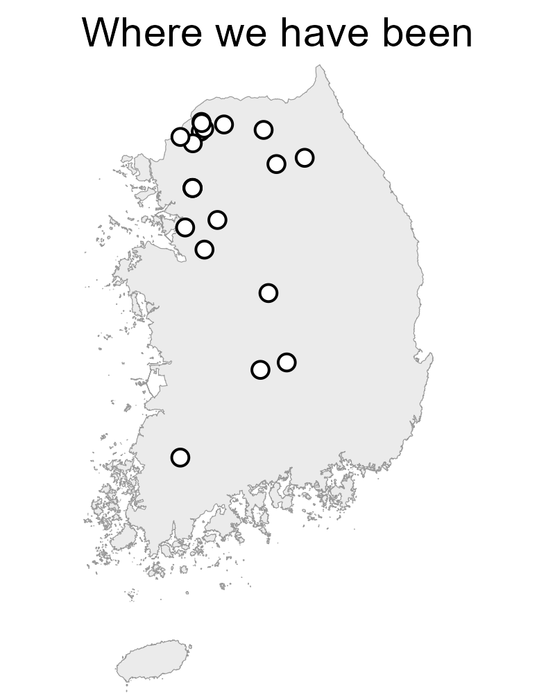{height="400"}
:::
::: {.column width="33%"}
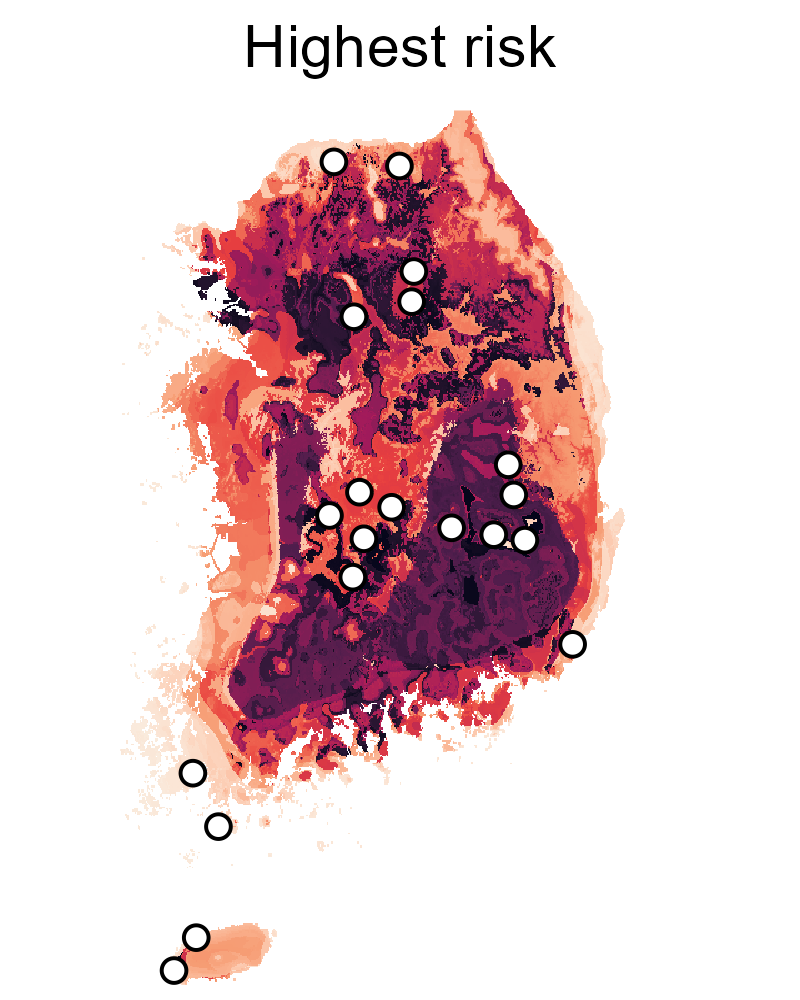{height="400"}
:::
::: {.column width="33%"}
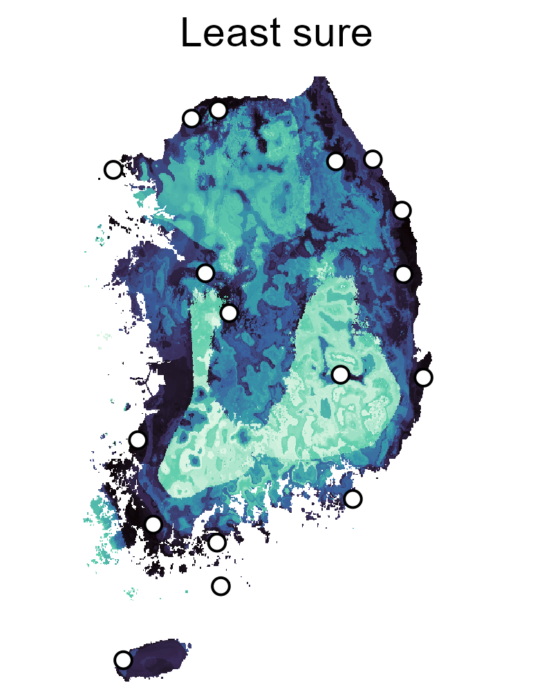{height="400"}
:::
::::

:::: {.columns style="text-align: center; font-size: 0.65em;"}
::: {.column width="33%"}
Return to past sites: change over time, or breadth?
:::
::: {.column width="33%"}
Highest predicted risk: does the model hold up?
:::
::: {.column width="33%"}
Where we can't tell high from low: can the model improve?
:::
::::

::: notes
Now the second half. Start with why we trap at all. Trapping costs a lot, and for us it's only worth it if it helps predict where people get sick. So the question is: what do we still need to learn about the hosts and the virus to predict human cases, and which sites teach us that?

Here are three ways of choosing new sites, and each one answers a different, valid question.

On the left, we go back to where we've been: the most-tested sites, mostly in the north-west. That gives us longitudinal data, so we see change over time at known sites, but it adds nothing about places we've never sampled. It's the trade-off between depth and breadth.

In the middle, we go where current models say risk is highest. That's a test of the model: if we find infected hosts there, the model holds up, and if we don't, we've learned it's wrong.

On the right, we go where the model can't tell whether risk is high or low. That's the one most likely to improve the model, because each result moves the map.

I'm not saying one of these is right. A real design will probably mix them, and that's a choice we make together later.

If asked: maps are the striped field mouse model from Catchen et al. 2026, as on the next slide. Left: 20 most-tested sites in the ArHa extract. Middle: 20 highest-risk cells, kept at least 20 km apart. Right: the country is split into a 3 by 6 grid and the most uncertain cell in each block is picked, giving 17 sites because some blocks are sea. Without the grid, the least-sure picks all sit on the coast and map edges. That's mostly because this uncertainty map is highest where predicted suitability is middling, which on the coast is where land meets sea, rather than where data are missing (next slide). The grid spreads the picks out but doesn't change that, so several are still coastal. Illustration only, not a sampling design.
:::

## Not all uncertainty is worth a trap {.smaller}

:::: {.columns}
::: {.column width="34%"}
- **Reducible:** we haven't looked there, or anywhere like it. More samples shrink it
- **Irreducible:** cells that look alike to the model still differ. Trapping one tells you about that cell, not the next one like it
- This map is mostly the second kind: highest where suitability is middling, near zero where the model is confident, even with no data nearby
- Downscaling to 1 km gives both kinds for human incidence (Python et al. 2022); site choice should use the reducible part
:::
::: {.column width="33%"}
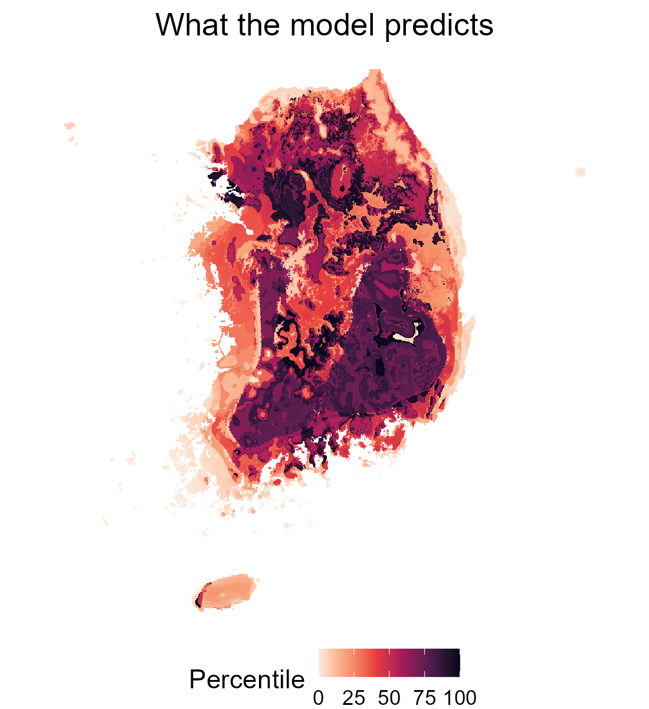{height="540"}
:::
::: {.column width="33%"}
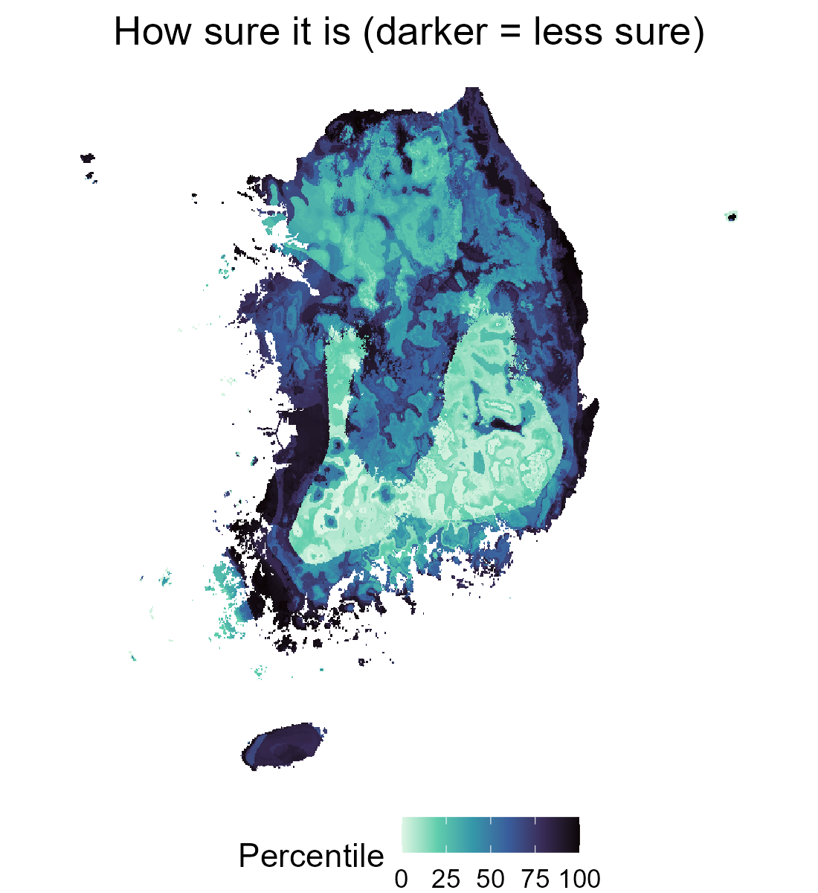{height="540"}
:::
::::

::: notes
On the last slide I said "least sure", so what does that actually mean? There are two reasons a model can be unsure about a place.

The first is that we just don't know enough. We've never trapped there, or anywhere like it. That kind shrinks when we sample, and it's the kind active learning is after.

The second is that cells which look the same to the model still differ. A prediction of 50% means that among all the cells with this climate and land cover, about half have the host. If we trap one of them thoroughly, we know about that cell, but the next cell that looks the same is still 50%, because the model can't tell them apart. That difference comes from things the model doesn't see: hedgerows smaller than a pixel, local extinctions, predators, chance. More traps in cells like it don't shrink it. Better inputs can, and that's what we hope the embeddings from Part A will do. So can a spatial term, if a trapped cell tells us about its neighbours.

The map on the right, from Catchen and colleagues, is mostly the second kind. I checked: it's highest where suitability is middling and close to zero where the model predicts near 0 or 1, even in places with no data at all. So the "least sure" sites on the last slide are mostly transition zones, not gaps in our knowledge.

That doesn't make the map wrong; it answers a different question. When we downscale to human incidence in WP3, a Bayesian model gives us both kinds, and for choosing sites we want the part that sampling can actually shrink.

If asked: the model is boosted regression trees with a Gaussian loss fitted to presence and pseudo-absence (0/1), via EvoTrees; the right map is the predicted σ of that Gaussian, from a single fit with no ensemble or posterior. Across about 200,000 cells per host, σ correlates with √(p(1−p)), the spread of a 0/1 outcome, at 0.82 for striped field mouse and brown rat and 0.72 for the shrew; σ is near zero at both ends of the predicted range. Predictions run from −0.15 to 1.17, because a Gaussian isn't bounded to 0 to 1. Its zeros are pseudo-absences, not trapped absences, so part of the spread reflects where background points landed. Imperfect detection is a separate, reducible source: more trap nights at a cell, and occupancy models with repeat visits. Their prevalence uncertainty, from kriging, is the reducible kind: it depends on distance from sampled sites. In INLA-SPDE, the reducible part is the posterior SD of the linear predictor (fixed effects plus spatial field); the full predictive SD adds the outcome variation back in.

Refs: Catchen et al. 2026, PLOS Ecosystems (code: OptimalSamplingBiosurveillance, src/sdms.jl). Python et al. 2022, JRSS A 185(1): 202 to 218. Lezama-Ochoa et al. 2020 for INLA-SPDE mean and SD maps.
:::

## The active learning loop

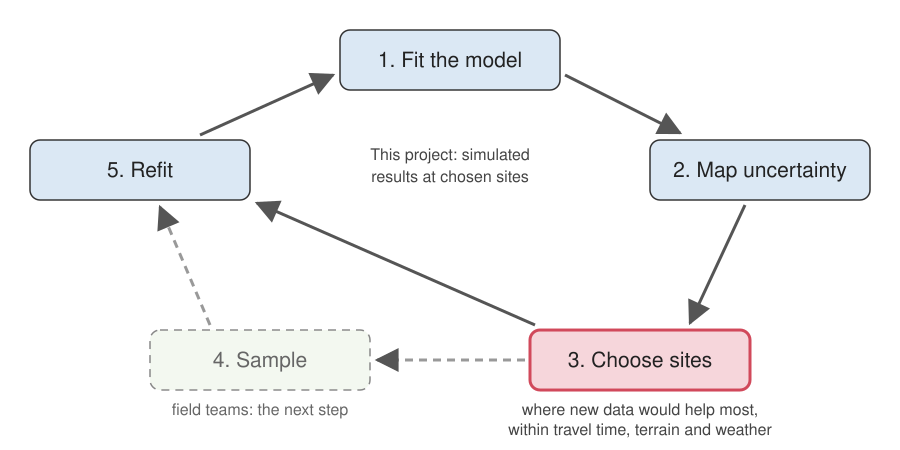{fig-align="center" height="520"}

::: notes
The loop itself is simple. Fit the model to what we have, map the uncertainty, pick the sites where new data would help most within what's logistically possible, go and sample, refit, and repeat.

In this project we don't send teams out. We simulate what they would find at the chosen sites and feed that straight back into the refit, which is the solid arrow across the middle. That lets us compare strategies many times over without spending trap nights. Real sampling by field teams, the dashed part, is the next step once the loop works.

Ref: Settles 2009/2012 for active learning in general.
:::

## Has this been done before? {.smaller}

| | Where | How it was tested | What it shows us |
|---|---|---|---|
| 1. Andrade-Pacheco et al. 2020 | Four countries, schistosomiasis and lymphatic filariasis | Simulation | The gain is real, if each batch is spread out |
| 2. Catchen et al. 2026 | South Korea, our hosts and the ArHa data | Priority maps, not tested | Look for hosts in some places, for infection in others |
| 3. Bengsen et al. 2026 | New South Wales, wild pigs | In the field, two years | It works with real teams, and sampled places lose value |

::: notes
Before the design choices, three examples of people doing this. They go from simulation, to our own country and data, to real field teams.

The first shows the gain in simulation. The second is the closest to us: same hosts, same data, and the code we're starting from. The third is the only one that has run with real teams over time.

None of them does all of it: none tests a loop in simulation for our system and then takes it to the field. That gap is roughly where we sit.
:::

## Example 1: hotspots with fewer samples {.smaller}

:::: {.columns}
::: {.column width="45%"}
- Andrade-Pacheco et al. 2020: schistosomiasis and lymphatic filariasis in four countries
- Sites chosen by the entropy of the probability of being a hotspot, spread out within each batch
- Matched the accuracy of 100 random sites with 7 to 50% of the samples
- Trade-off: better at classifying hotspots, worse at overall prediction error
:::
::: {.column width="55%"}
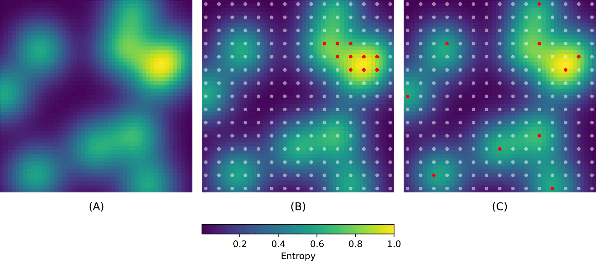{width="100%"}

::: {style="font-size: 0.7em;"}
Left: uncertainty. Middle: the most uncertain sites, which cluster. Right: the batch spread out. Figure 3 from Andrade-Pacheco et al. 2020, Sci Rep, CC BY 4.0
:::
:::
::::

::: notes
This has been done for other diseases. Andrade-Pacheco and colleagues did it for schistosomiasis and lymphatic filariasis in four countries, in simulation.

The figure shows the main practical point. On the left is the uncertainty: how unsure the model is whether each place is a hotspot. If you just take the most uncertain sites, in the middle, they all land in one blob, and they tell you much the same thing. On the right, they pick the batch so it's both uncertain and spread out.

They matched the accuracy of 100 random sites with between 7 and 50% of the samples. The trade-off was that it got better at classifying hotspots but worse at overall prediction. And there were no logistics in it.

Ref: Sci Rep 10: 10939. Their Figure 1 shows accuracy climbing faster than random sampling in all four countries.
:::

## Example 2: South Korea, same hosts and data {.smaller}

:::: {.columns}
::: {.column width="50%"}
- Catchen et al. 2026: host distribution models plus prevalence data from ArHa
- Discovery sampling where host presence is uncertain (north-west, around Seoul)
- Prevalence sampling where hosts are certain but prevalence is not (south-east)
- Our code base starts from this case study
:::
::: {.column width="50%" style="text-align: center;"}
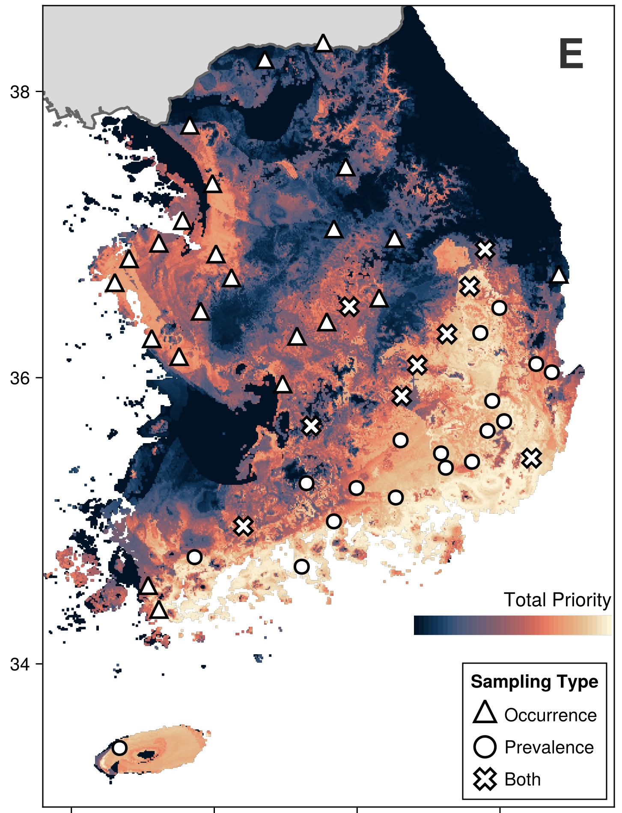{height="540"}

::: {style="font-size: 0.7em;"}
Panel E of the South Korea figure, Catchen et al. 2026, PLOS Ecosystems, CC BY 4.0
:::
:::
::::

::: notes
Closer to home, Catchen and colleagues did this for South Korea, with the same hosts and the ArHa prevalence data.

They separate two kinds of sampling. Discovery sampling, where we're not sure whether the host is there: those are the triangles, mostly in the north-west around Seoul. And prevalence sampling, where we know the host is there but not how much infection there is: the circles, in the south-east. The crosses are both. Our code base starts from this case study.

If asked: their discovery sampling is chosen with the same host uncertainty map as on "Not all uncertainty is worth a trap", which is mostly the irreducible kind. So the north-west may be a band of middling suitability rather than a gap in host data. Their prevalence uncertainty, from kriging, is the reducible kind. Sites are placed with balanced acceptance sampling, so they spread out.

Ref: PLOS Ecosystems 1(1): e0000023. Hosts: A. agrarius, R. norvegicus, C. lasiura; viruses: Hantaan, Seoul, Imjin.
:::

## Example 3: tested in the field {.smaller}

:::: {.columns}
::: {.column width="50%"}
- Bengsen et al. 2026: wild pigs across New South Wales, 1,964 animals over two years
- Search value updated every three months from the sampling actually done: a sampled cell drops, even if its risk stays high
- Sites balance search value against spread; 74 to 88% of sampled cells were still high risk
- Built for foot-and-mouth disease, but also found Japanese encephalitis virus at sites other JEV models rated low to moderate risk
:::
::: {.column width="50%" style="text-align: center;"}
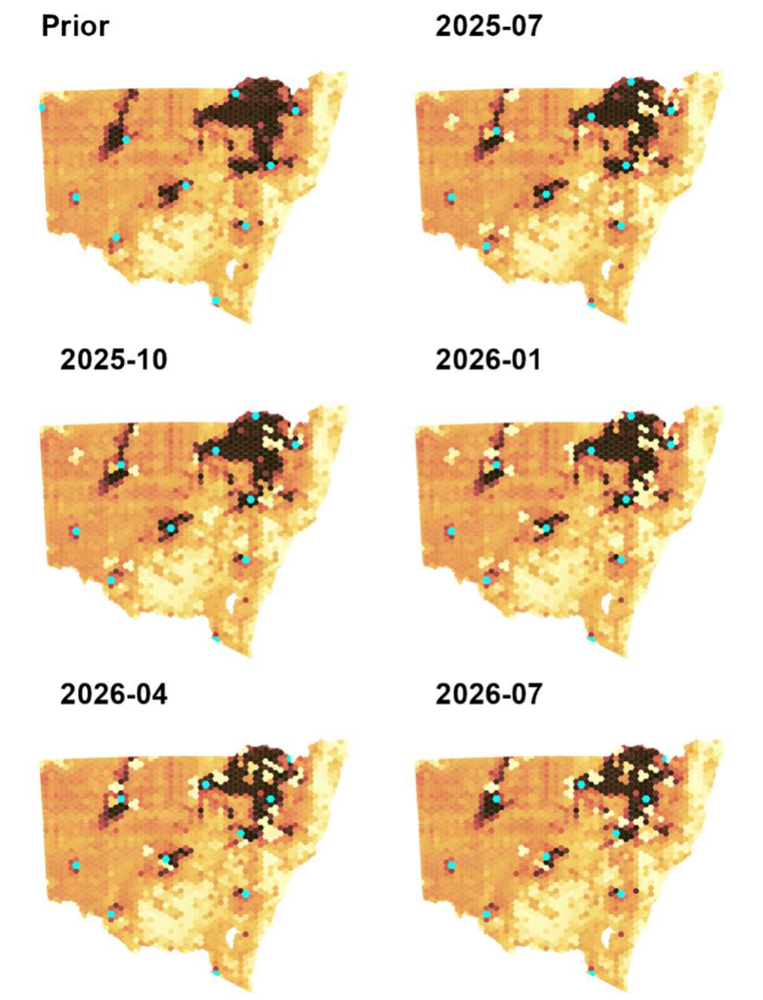{height="540"}

::: {style="font-size: 0.7em;"}
Search value, updated every three months; cyan = chosen cells. Figure 3 from Bengsen et al. 2026, bioRxiv, CC BY-NC-ND 4.0
:::
:::
::::

::: notes
And it has been tried in the field. Bengsen and colleagues sampled nearly 2,000 wild pigs across New South Wales over two years.

The maps show the idea. Dark is high search value. Every three months they update it from the sampling they actually managed, and you can see the dark block in the north-east getting patchy: once a cell has been sampled properly, it's worth less to go back, even though its risk hasn't changed. The cyan cells are the next targets, chosen to balance value against spread.

Most of their effort still went to high-risk cells, about three-quarters or more. But the spread paid off. The programme was built around foot-and-mouth disease, yet the same pig samples picked up Japanese encephalitis virus, at sites that other groups' JEV models rated low to moderate risk, and before it was detected in people or livestock.

It's a preprint, so not peer reviewed yet. Their aim was detecting incursions, whereas ours is reducing uncertainty in an endemic map, so we'll need to adapt the update rule.

If asked: their risk map was for foot-and-mouth disease, used as a weak prior; FMD tests weren't available, so the JEV and Brucella suis findings were secondary. Search value = prior × probability of detection, with 30 pigs per site giving 95% detection at 10% prevalence.

Ref: bioRxiv, doi 10.64898/2026.08.31.748179.
:::

## Where this leaves us

:::: {.columns}
::: {.column width="55%"}
- Surveillance data record where people looked, so a model trained on them learns the looking as well as the hazard
- Embeddings describe a landscape without us choosing the variables first, and we test whether that predicts better
- Uncertainty is a map in its own right, and the part sampling can shrink is the part worth a trap
- The loop is only useful if it survives the field, so logistics and simulation come before any sampling plan
:::
::: {.column width="45%" style="text-align: center;"}
{height="380"}
:::
::::

::: notes
To finish, four things to take away.

Surveillance data record where people looked. A model trained on them learns the looking as much as the hazard, and for South Korea that means the north-west.

Embeddings let the landscape describe itself, rather than us picking bands and indices first. Whether that predicts better for rodents is an open question we test against standard covariates.

Uncertainty is a map in its own right. Not all of it is worth a trap, and the part sampling can shrink is the part that should choose sites.

And none of this matters if the loop can't be run. The sites have to be reachable, in the right season, by the people who do the trapping.
:::
